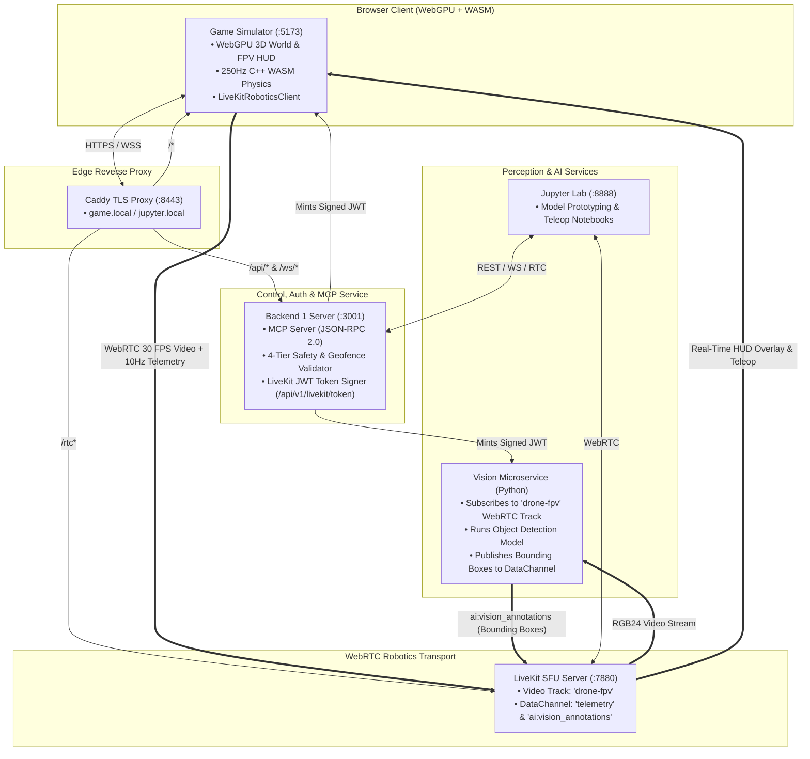

# Masiez — Autonomous AI Drone & WebRTC Vision Platform


<p align="center">
  
  
  
  
  
  
</p>

> **An end-to-end autonomous UAV testbed combining 250Hz C++/WASM flight physics, custom WebGPU 3D worlds, sub-100ms LiveKit WebRTC video streaming, real-time AI computer vision tracking, and Model Context Protocol (MCP) flight control.**

---

## Overview

Developing, testing, and validating autonomous drone perception and control in the physical world is costly and hazardous—a single collision or sensor glitch destroys hardware. Traditional desktop simulators require bulky local setups and lack native web accessibility or standardized LLM/VLM tool interfaces.

**Masiez** bridges high-fidelity flight simulation, real-time computer vision, and autonomous AI agents directly in the browser. Built with **Simulation Parity** as a core design principle, the exact same AI vision pipeline, LiveKit WebRTC transport, and MCP control interface can drive either our simulated UAV or a physical MAVLink drone.

---

## Key Features

### 1. Custom WebGPU 3D Engine & 5 Large-Scale Environments
Built from scratch in TypeScript over the native **WebGPU API** with custom **WGSL shaders** (PBR metallic-roughness/specular-glossiness city rendering, terrain heightmaps, atmospheric sky scattering, and volumetric combat effects):
- **`[1]` Tactical Airfield Runway** — Open runway with hangars, radar towers, moving ground vehicles, and obstacle courses.
- **`[2]` Downtown City Streets** — Dense urban commercial sector with avenues, storefronts, and high-rise colliders.
- **`[3]` Tram Metropolis** — Modern transit district with overhead rail networks and multi-story buildings.
- **`[4]` Amsterdam Terminal** — Waterfront canals and historic station complex.
- **`[5]` Erangel Battleground (PUBG)** — 20km × 20km island terrain with 16-bit heightmap elevation and military outposts.

### 2. 250Hz C++ / WebAssembly 6-DoF Flight Physics & Crash Mechanics
- **Deterministic Sub-Step Physics**: Runs at a fixed 250Hz loop in WebAssembly with cascaded PID attitude/altitude stabilization, aerodynamic drag, and three dynamic flight profiles (`CRUISE`, `SPORT`, `TURBO`).
- **Swept AABB & Heightmap Collision Resolution**: Anti-tunneling continuous collision checks against solid 3D buildings, towers, trees, vehicles, and terrain.
- **Realistic Airframe Crash System**: Touching any structure, vehicle, or ground surface at excessive impact velocity or extreme bank angle immediately cuts motors, triggers airframe breach alarms, and requires base recovery.

### 3. First-Person Operator View (FPV) & Tactical Targeting HUD
- **Gimbal FPV & Chase Cameras**: Default operator First-Person View (`[V]` to toggle Chase cam) with real-time On-Screen Display (OSD): artificial horizon pitch ladder, sliding compass tape, altitude/airspeed ladders, and GPS readout.
- **Multi-Stage Scope Gearing**: Optical zoom (`1X` $\rightarrow$ `2X` $\rightarrow$ `4X` $\rightarrow$ `8X`) with automatic weapon mode switching (`Dual Plasma` vs. `High-Velocity Sniper Railgun`).
- **Hard Target Lock & Predictive Lead Pip**: Raycast and angular-cone target acquisition (`[T]` / Middle-Click) that computes 3D intercept lead points for moving aerial and ground targets.

### 4. LiveKit Robotics WebRTC Streaming & Data Channels
Following the [LiveKit Robotics](https://docs.livekit.io/robotics/) architecture:
- **Zero-Copy WebRTC Video Track (`drone-fpv`)**: Captures the WebGPU canvas stream at 30 FPS and publishes it to the LiveKit SFU for sub-100ms remote viewing and AI ingestion.
- **Low-Latency Robotics Data Channel**: Streams 10Hz telemetry packets (`drone:telemetry`) and receives remote teleoperation commands (`teleop:command`) and real-time AI vision detections (`ai:vision_annotations`).

### 5. Real-Time AI Computer Vision Microservice
- A dedicated Python microservice (`vision/`) joins the LiveKit room as a subscriber, decodes incoming WebRTC video frames into `RGB24` NumPy arrays, runs object detection inference, and publishes normalized bounding boxes and confidence scores back to the room's data channel.
- The operator HUD renders these AI bounding boxes (`AI: LABEL [CONF%]`) live over the FPV feed.

### 6. Model Context Protocol (MCP) & 4-Tier Safety Middleware
- Exposes standardized **MCP Tools** (`arm_and_takeoff`, `goto_location`, `orbit_point`, `land`, `return_to_launch`, `emergency_stop`) and **MCP Resources** (`drone://telemetry/*`, `drone://camera/snapshot`, `drone://safety/geofence`) over JSON-RPC 2.0 and REST.
- Enforces **4-Tier Defense-in-Depth Safety**: AI prompt constraints $\rightarrow$ API middleware validation (polygon ray-casting geofence, altitude ceiling, battery RTL reserve) $\rightarrow$ Flight controller failsafes $\rightarrow$ Human operator override.

---

## Microservice Architecture



---

## Flight & Operator Controls

| Key / Input | Action | Description |
| :--- | :--- | :--- |
| **`W` / `S`** | Pitch Forward / Backward | Horizontal forward and reverse thrust |
| **`A` / `D`** | Roll Left / Right | Horizontal strafe left and right |
| **`Shift`** | Climb | Ascend vertically |
| **`Ctrl`** | Descend | Descend vertically |
| **`Q` / `E`** | Yaw Left / Right | Rotate drone compass heading |
| **`Mouse Move`** | Gimbal / Pitch & Yaw Aim | 360° pointer-lock operator look and reticle aim |
| **`Left-Click` / `F`** | Fire Weapon | Fire dual plasma cannons or high-velocity railgun |
| **`Right-Click` / `Z`** | Toggle Scope (ADS) | Engage/disengage optical zoom scope |
| **`X` / `Scroll`** | Cycle Scope Gear | Step magnification (`1X` $\rightarrow$ `2X` $\rightarrow$ `4X` $\rightarrow$ `8X`) |
| **`Middle-Click` / `T`** | Lock Target | Acquire or cycle hard lock on nearest target in sight |
| **`V` / `C`** | Toggle Camera View | Switch between **Operator FPV** and **3rd-Person Chase** |
| **`R`** | Cycle Speed Mode | Switch flight profile (`CRUISE` $\rightarrow$ `SPORT` $\rightarrow$ `TURBO`) or recover after crash |
| **`Space`** | Arm / Disarm / Recover | Toggle motor arming or recover airframe to base after crash |
| **`K`** | Toggle Camera Stream | Pause or resume live camera frame streaming |
| **`M`** | Mute Audio | Toggle procedural WebAudio flight & combat sound synthesis |
| **`1` – `5`** *(or Numpad)* | Switch Map | Instantly deploy to Map `1` through `5` |
| **`Esc`** | Unlock Mouse Pointer | Release pointer lock to click HUD toolbar buttons |

---

## Quick Start

### Option 1: Docker Compose (Full Microservice Stack)

#### 1. Map local hostnames
Add the following entries to your system `hosts` file (`/etc/hosts` on Linux/macOS or `C:\Windows\System32\drivers\etc\hosts` on Windows):

```text
127.0.0.1 game.local
127.0.0.1 jupyter.local
```

#### 2. Build and start all services
```bash
docker compose up --build
```

#### 3. Open the interfaces
- **Drone Simulator & HUD**: [https://game.local:8443](https://game.local:8443)
- **Jupyter Vision Prototyping**: [https://jupyter.local:8443](https://jupyter.local:8443)
- **Backend REST API**: `http://localhost:3001/api/v1`
- **LiveKit WebRTC SFU**: `ws://localhost:7880`

> **Note on TLS Certificates**: Caddy automatically generates internal TLS certificates (`tls internal`). Accept the self-signed certificate on first visit, or install Caddy's root CA so WebRTC secure WebSockets (`wss://`) connect without browser warnings.

#### Stop services
```bash
docker compose down       # stop containers
docker compose down -v    # stop and wipe volumes/certificates
```

---

### Option 2: Local Development (Node.js + Vite)

#### Prerequisites
- **Node.js** v20+ and **npm**
- A modern browser with **WebGPU** enabled (Chrome 113+, Edge 113+, or Firefox Nightly)
- *(Optional)* **Docker** for running `livekit-server` and the Python `vision` service

#### Install & Run
```bash
# 1. Install workspace dependencies (shared, server, game)
npm install

# 2. Start Backend 1 (:3001) and WebGPU Game Client (:5173) concurrently
npm run dev
```

Open **[http://localhost:5173](http://localhost:5173)** in your browser.

To build all packages for production:
```bash
npm run build
```

---

## API & Protocol Reference

### REST Endpoints (`http://localhost:3001/api/v1`)

| Method | Endpoint | Description |
| :--- | :--- | :--- |
| `GET` / `POST` | `/livekit/token` | Mint a signed LiveKit JWT (`?identity=drone-sim&room=drone`) |
| `GET` | `/drone/telemetry` | Latest 10Hz telemetry snapshot (GPS, attitude, battery, wind, sensors) |
| `GET` | `/drone/sensors` | Health status of IMU, GPS, compass, barometer, rangefinder, cameras |
| `GET` | `/drone/camera/snapshot` | Latest JPEG/WebP camera frame (`?format=json` for metadata + base64) |
| `GET` | `/drone/mission/state` | Current deterministic Finite State Machine state |
| `GET` | `/drone/geofence` | Active polygon geofence vertices and altitude limits |
| `POST` | `/drone/command` | Validate and execute a drone command through the safety pipeline |

### WebSocket & WebRTC Channels
- **Game WebSocket**: `ws://localhost:3001/ws/game` (streams `game:telemetry` and `game:camera_frame`)
- **AI Subscriber WebSocket**: `ws://localhost:3001/ws/ai` (receives real-time broadcasts of `ai:telemetry` and `ai:camera_frame`)
- **LiveKit Room (`drone`)**:
  - Video Track: `drone-fpv` (30 FPS WebRTC canvas stream)
  - Data Channel Topic `telemetry`: 10Hz lossy real-time telemetry packets
  - Data Channel Payload `ai:vision_annotations`: Real-time object detection bounding boxes from `vision/`

---

## Project Structure

```text
├── game/                          # Subsystem A: WebGPU 3D Simulator & FPV Client
│   ├── public/assets/             # 3D GLB maps, drone models, heightmaps, WASM binaries
│   └── src/
│       ├── camera/                # CameraStreamer (WebSocket JPEG downscaler)
│       ├── gameplay/              # CollisionSystem, EntityManager, WeaponSystem, MissionManager, SoundManager
│       ├── gpu/                   # WebGPU Device, CityMapRenderer, TerrainRenderer, SkyRenderer, CombatRenderer
│       ├── hud/                   # Tactical OSD, Scope Gearing, AI Bounding Box Overlay
│       ├── input/                 # Keyboard, Mouse Pointer-Lock & Gamepad InputManager
│       ├── network/               # LiveKitRoboticsClient (WebRTC video track & data channels)
│       ├── scene/                 # Gimbal FPV & Orbit Chase Camera math
│       ├── shaders/               # Custom WGSL shaders (city_map, terrain, sky, structures, model, combat)
│       └── wasm/                  # PhysicsBridge (250Hz C++ 6-DoF physics & synthetic sensors)
├── server/                        # Subsystem B: Control, Safety, Auth & MCP Server
│   └── src/
│       ├── api/                   # Express REST routes & LiveKit JWT token endpoint
│       ├── drone/                 # Finite State Machine (DroneState), DroneCommands, TelemetryStore
│       ├── mcp/                   # Model Context Protocol JSON-RPC 2.0 server, Tools & Resources
│       ├── safety/                # Polygon Geofence ray-caster & 4-tier SafetyValidator
│       └── websocket/             # Dual WebSocket hub (/ws/game & /ws/ai) and MessageRouter
├── shared/                        # Shared TypeScript interfaces, message unions, and PID constants
├── vision/                        # Subsystem C: Python AI Vision Microservice
│   ├── server.py                  # LiveKit WebRTC video subscriber & DataChannel annotation publisher
│   └── model.py                   # Detector interface & inference pipeline
├── notebooks/                     # Interactive Jupyter Lab environment for perception prototyping
├── specs/                         # Architectural & behavioral specifications
├── Caddyfile                      # Internal TLS reverse proxy routing
├── docker-compose.yml             # Multi-container orchestration
└── livekit.yaml                   # LiveKit SFU server configuration
```

---

## Specifications

All behavioral specifications are framework-agnostic and located in [`specs/`](specs/):

| Specification | Description |
| :--- | :--- |
| [Project Overview](specs/project-overview.md) | Vision, subsystem boundaries, design principles, and phasing |
| [3D World Spec](specs/3d-world.md) | Environment requirements, physics separation, and synthetic sensors |
| [Drone API Spec](specs/drone-api.md) | MCP interface contract — tools, resources, state machine, and 4-tier safety |
| [AI Agent Spec](specs/ai-agent.md) | Mission lifecycle, visual perception pipeline, and fallback behaviors |
| [User Interface Spec](specs/user-interface.md) | Operator HUD, telemetry readouts, autonomous mode, and human overrides |

---

## License

MIT
