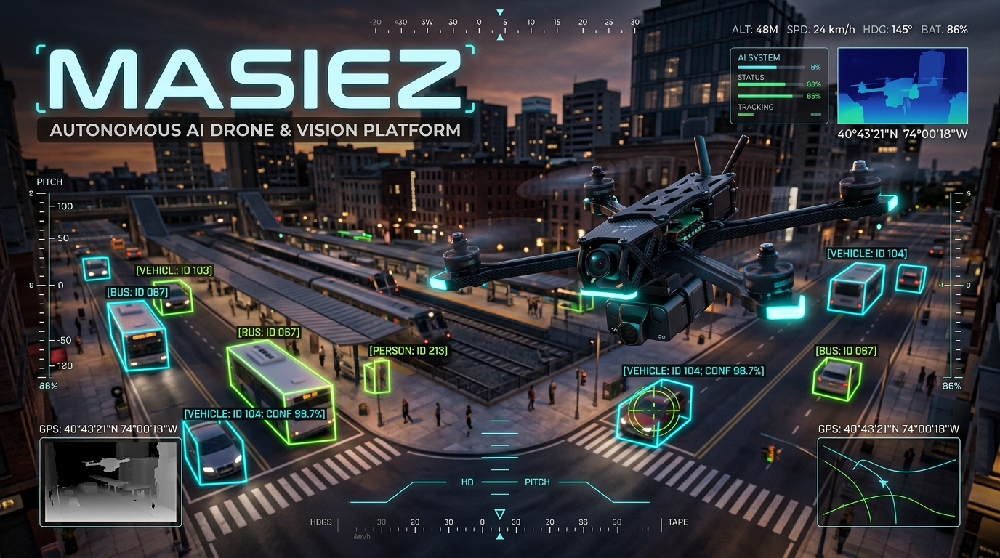

# Masiez — Autonomous AI Drone & WebRTC Vision Platform



> **An end-to-end autonomous UAV testbed combining 250Hz C++/WASM flight physics, WebGPU 3D worlds, sub-100ms LiveKit WebRTC video streaming, and real-time AI computer vision tracking.**

An autonomous drone system composed of independent, decoupled microservices:

1. **Interactive 3D World (`game/`)** — Real-time WebGPU & C++ WebAssembly 250Hz 6-DoF flight simulator with 5 environments, FPV gimbal optics, tactical scope gearing, and LiveKit WebRTC camera/telemetry streaming
2. **Drone API / MCP (`server/`)** — Node.js/TypeScript control & safety middleware exposing drone telemetry, geofencing, LiveKit JWT auth, and navigation commands via the Model Context Protocol (JSON-RPC 2.0)
3. **LiveKit Robotics SFU (`livekit`)** — Sub-100ms WebRTC video transport and bidirectional lossy/reliable robotics data channels
4. **AI Vision & Autonomy (`vision/` & `notebooks/`)** — Python computer vision subscriber that pulls the live WebRTC drone camera track, runs real-time object detection, and streams bounding-box annotations back to the operator HUD

## Architecture

```
┌──────────────────┐     MCP (JSON-RPC 2.0)     ┌──────────────────┐
│                  │◄───── Tools & Resources ────►│                  │
│    AI Agent      │                              │  Drone MCP       │
│  (LLM / VLM)    │                              │  Server          │
└──────────────────┘                              └────────┬─────────┘
                                                           │
                                                    MAVSDK / MAVLink
                                                           │
                                                  ┌────────▼─────────┐
                                                  │  Flight Controller│
                                                  │  (PX4 SITL)      │
                                                  └────────┬─────────┘
                                                           │
                                                  ┌────────▼─────────┐
                                                  │  3D World         │
                                                  │  (Simulator)      │
                                                  └──────────────────┘
```

## Specifications

All specs are framework-agnostic, human-readable, and serve as the source of truth:

| Spec | Description |
|---|---|
| [Project Overview](specs/project-overview.md) | Vision, architecture, design principles, phasing |
| [3D World](specs/3d-world.md) | Environment, drone model, sensor simulation, scene types |
| [Drone API](specs/drone-api.md) | MCP interface contract — tools, resources, state machine, safety |
| [AI Agent](specs/ai-agent.md) | Mission lifecycle, vision pipeline, decision patterns |
| [User Interface](specs/user-interface.md) | Chat, dashboard, autonomous mode, human overrides |

## Design Principles

- **Framework Agnostic** — Specs describe WHAT, not HOW. Same specs, any language.
- **Simulation Parity** — Identical API for simulated and physical drones.
- **Safety by Default** — 4-tier defense in depth.
- **Model Agnostic** — Any AI model with tool-calling and vision support.

## Project Structure

```
├── game/              # WebGPU 3D Simulator, C++ WASM Physics, FPV HUD & LiveKit WebRTC Publisher
├── server/            # Backend 1 — MCP Server, Safety/Geofence Validator, WebSocket Hub & LiveKit Auth
├── shared/            # Shared TypeScript types, telemetry schemas, and PID/flight constants
├── vision/            # Python Computer Vision Microservice (LiveKit WebRTC subscriber & detector)
├── notebooks/         # Jupyter prototyping environment for vision & perception models
├── specs/             # Source of truth — framework-agnostic behavioral specifications
├── docker-compose.yml # Full microservice orchestration (Caddy TLS, Game, Server, LiveKit, Vision, Jupyter)
└── livekit.yaml       # LiveKit SFU configuration
```

## Development (Docker Compose)

### 1. Map the local hostnames

Add to your hosts file:

```
127.0.0.1 game.local
127.0.0.1 jupyter.local
```

### 2. Start and open

```
docker compose up --build
```

Browse to **https://game.local:8443** and accept the self-signed certificate on first visit.

Caddy routes `/rtc/*` to LiveKit (7880), `/ws/*` and `/api/*` to the server (3001), everything else to the game client (5173). Jupyter is served at **https://jupyter.local:8443** (HTTP and kernel WebSockets proxied through Caddy).

Caddy generates its certificates itself via an internal CA (`tls internal`) — there is no manual `openssl` step. It is enough to click through the warning for plain browsing, but browsers will not open a secure WebSocket to an untrusted certificate, so any browser that talks to LiveKit needs the CA installed (or a locally-trusted cert such as `mkcert`) instead of an exception.

### Stop

```
docker compose down       # stop
docker compose down -v    # also wipe Caddy certificates/state
```

Source directories are bind-mounted, so edits hot-reload; rebuild only after changing a `package.json`.

## License

TBD
