# 3D World Simulation Environment Specification

**Document Status:** Draft  
**Version:** 1.0.0  
**Target Audience:** System Architects, Simulation Engineers, Autonomous Systems Engineers, QA/Verification Engineers  
**Related Documents:** [Drone API Specification](drone-api.md)

---

## 1. Purpose & Scope

The 3D World Simulation Environment provides an interactive, physically grounded virtual operating theater for autonomous unmanned aerial vehicle (UAV) systems. It serves as the visual and sensory counterpart to the flight control stack, providing realistic synthetic sensor streams, spatial environments, and physical interaction boundaries.

### 1.1 Core Objectives
- **Photorealistic & Spatial Realism:** Render high-fidelity, geometrically precise 3D environments across varied terrains, structures, and atmospheric conditions.
- **Synthetic Sensor Emulation:** Generate accurate visual, inertial, positioning, and ranging sensor feeds matching the physical characteristics and noise profiles of real-world drone sensor suites.
- **Strict Separation of Concerns:** Decouple flight dynamic modeling from visual and environmental rendering. Flight dynamics and motor authority are governed externally by a Software-In-The-Loop (SITL) flight controller simulator, while the 3D World provides environmental boundary conditions, collision detection, and sensory readouts.
- **Dual-Perspective Visualization:** Provide simultaneous rendering pipelines for synthetic perception (the AI agent's sensory inputs) and external human supervision (third-person observation, free camera, and tactical minimap).

### 1.2 System Context & Architectural Flow

The 3D World operates as a peer to the flight controller simulator and does not expose direct operational endpoints to autonomous agent software. All behavioral commands and operational states route through standard flight control channels.

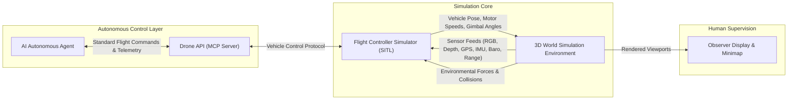

---

## 2. Environment Requirements

The simulation environment must support large-scale, topologically diverse geographic regions with collision geometry, realistic illumination, and dynamic atmospheric phenomena.

### 2.1 Terrain

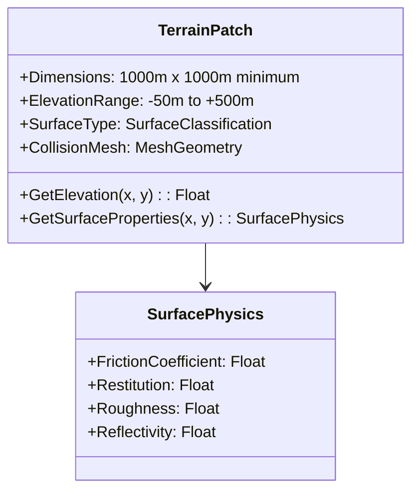

#### 2.1.1 Spatial Extents and Coordinate Frame
- **Navigable Area:** The simulated world must provide a contiguous navigable terrain of at least 1,000 meters × 1,000 meters (1 km²).
- **Coordinate Reference:** The world must operate in a standardized right-handed local Cartesian frame (East-North-Up or North-East-Down) linked to an anchored geographic origin (Latitude, Longitude, Altitude above WGS-84 ellipsoid).
- **Elevation Profiles:** The terrain must incorporate diverse elevation topographies including planar flats, rolling hills, steep ravines, and vertical cliffs.

#### 2.1.2 Surface Classification & Physical Properties
The terrain must be partitioned into identifiable surface types, each exposing distinct physical and visual characteristics:

| Surface Type | Physical Friction | Restitution (Bounce) | Optical Reflectance | Typical Application |
|---|---|---|---|---|
| **Asphalt / Concrete** | High (0.85) | Low (0.15) | Low matte / specular when wet | Runways, roads, helipads |
| **Grass / Turf** | Moderate (0.60) | Low (0.05) | Diffuse green vegetation | Open fields, parks |
| **Dirt / Soil** | Moderate (0.55) | Low (0.02) | Diffuse brown | Construction, agricultural trails |
| **Sand** | High rolling resistance | Negligible (0.01) | High diffuse scatter | Deserts, coastal banks |
| **Water Surface** | Negligible (0.05) | Absorptive (0.00) | High specular / fresnel | Lakes, rivers, retention ponds |

#### 2.1.3 Ground Collision
- The entire terrain surface must provide continuous collision surfaces.
- Downward altitude inquiries (raycasts) and physical contact inquiries must resolve with sub-centimeter vertical accuracy against the surface mesh.

---

### 2.2 Structures, Infrastructure & Static Objects

To simulate complex mission environments, the world must incorporate structural geometry with explicit collision boundaries.

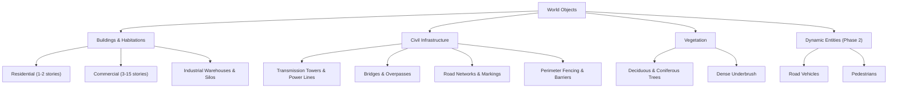

#### 2.2.1 Buildings and Industrial Structures
- **Structural Typology:** Support for residential homes, multistory commercial towers, hangars, industrial silos, storage tanks, and pipe complexes.
- **Roof Profiles:** Flat roofs with HVAC equipment, pitched gable roofs, and parapet perimeters for rooftop landing and inspection testing.
- **Collision Bounds:** Every structure must have an impenetrable collision boundary matching its visual exterior within a tolerance of ±5 centimeters.

#### 2.2.2 Infrastructure Elements
- **Thin Obstacles:** Power transmission lines, telecommunication cables, and wire fences must possess valid collision boundaries.
- **Transportation Corridors:** Multi-lane roadways, bridges with underpasses (allowing traversal beneath deck level), and marked pedestrian walkways.

#### 2.2.3 Vegetation
- **Vegetation Models:** Tree canopies, individual trunks, and hedge lines.
- **Collision Approximations:** Tree trunks must provide rigid solid cylinder collisions; canopies must provide configurable penetration boundaries (either rigid bounding volumes or probabilistic velocity-damping zones).

#### 2.2.4 Dynamic Entities (Phased Roadmap)
- **Phase 1 (Static Environment):** All structures, vehicles, and vegetation remain stationary.
- **Phase 2 (Dynamic Environment):** Introduction of moving road vehicles following prescribed traffic networks, and pedestrians navigating sidewalk paths with predictable velocity vectors.

---

### 2.3 Sky, Lighting & Atmosphere

The rendering system must model diurnal cycles and atmospheric illumination to challenge computer vision algorithms under changing light levels.

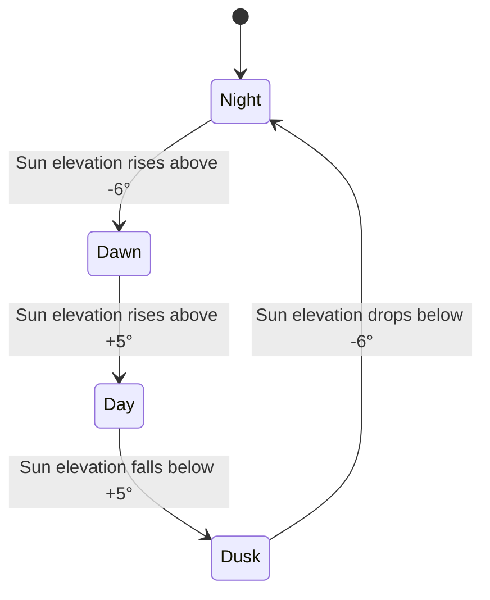

#### 2.3.1 Sun and Diurnal Cycle
- **Ephemeris Calculation:** The sun's astronomical position (elevation and azimuth) must be calculated based on simulated calendar date, time-of-day, and world geographic latitude/longitude.
- **Solar Trajectory:** Supports full 24-hour cycle progression, enabling dawn, midday, golden hour, twilight, and full night missions.
- **Shadow Projection:** Directional sun and moon illumination must cast dynamic shadows with distance-dependent resolution.

#### 2.3.2 Illumination Parameters
- **Direct Sunlight:** Dynamic intensity ranging from 0 Lux (overcast night) up to 100,000 Lux (clear zenith noon).
- **Color Temperature:** Realistic shift from warm low-angle light (2,500 Kelvin at dawn/dusk) to daylight neutral (5,500–6,500 Kelvin at midday).
- **Ambient Fill:** Sky dome ambient light matching atmospheric scatter (Rayleigh and Mie scattering approximations).

---

### 2.4 Progressive Weather System

The weather model influences both visual sensor fidelity and environmental vectors passed to the flight controller.

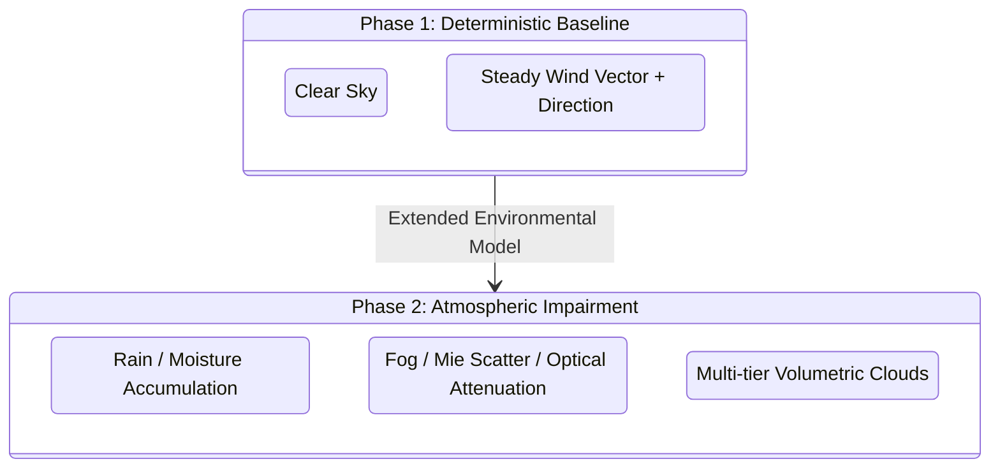

#### 2.4.1 Phase 1 Weather Capabilities (Baseline)
- **Clear Atmosphere:** Standard visual range (nominal 10 km visibility).
- **Adjustable Wind Field:** 
  - User-configurable mean horizontal wind speed ($0\text{ to }25\text{ m/s}$).
  - User-configurable wind heading ($0^\circ\text{ to }360^\circ$ relative to true North).
  - Configurable turbulence and gust variance (sinusoidal + stochastic wind bursts).
  - Wind vector transmitted continuously to the flight controller simulator.

#### 2.4.2 Phase 2 Weather Capabilities (Advanced)
- **Fog and Particulate Scattering:**
  - Configurable ground visibility distance ($10\text{ m to }5,000\text{ m}$).
  - Exponential light extinction reducing contrast and dynamic range in synthetic camera feeds.
- **Precipitation:**
  - Rain simulation with variable rates ($0\text{ to }50\text{ mm/hr}$).
  - Lens droplet rendering on drone camera viewport.
  - Surface specular reflections and wetness maps on ground terrain.
- **Cloud Stratification:**
  - Layered cloud ceilings (low stratus, mid-level cumulus, high cirrus) affecting solar obstruction and shadow casting.

---

## 3. Drone Representation & Kinematics

The simulated drone represents a standard multirotor platform equipped with navigation systems, physical chassis geometry, and articulated payload cameras.

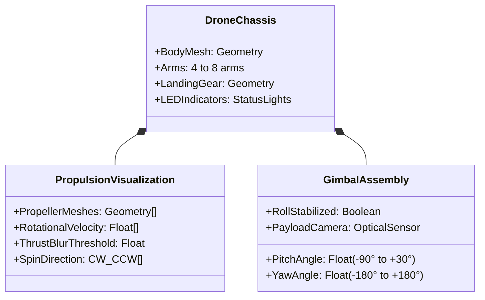

### 3.1 Visual Representation
- **Airframe Geometry:** Distinct central avionics fuselage, symmetrical motor booms, landing struts, and motor pods.
- **Propeller Animation:**
  - Dynamic rotational blur scaled directly to motor RPM signals received from the flight controller.
  - Propeller color differentiation (e.g., high-visibility front rotors vs. dark rear rotors) to aid human orientation recognition.
- **Navigation Lights:**
  - Left forward boom: Port red indicator light.
  - Right forward boom: Starboard green indicator light.
  - Aft boom: White position light.
  - Fuselage status beacon: Programmable pulsing LED indicating system arming, GPS lock, or failure state.
- **Gimbal Fixture:** Articulated camera casing visibly mounted beneath the chassis, mirroring current pitch and yaw angles.

---

### 3.2 Physics Integration & Data Separation

The 3D World does **not** compute internal multirotor aerodynamics, motor mixing, or flight stability equations. It operates strictly as an environmental host and rendering engine.

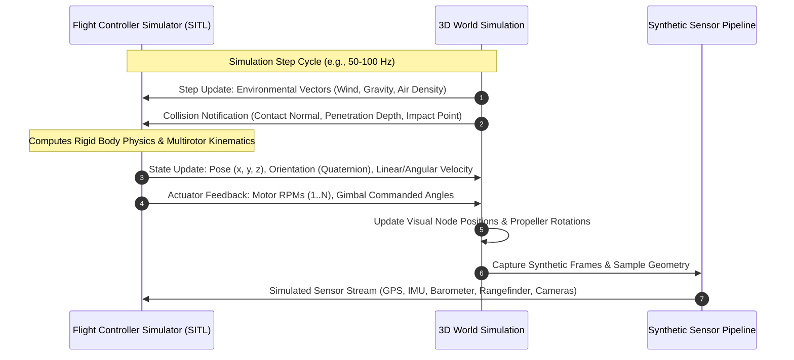

#### 3.2.1 Environmental Data Dispatched to Simulator
- Gravity vector (magnitude and direction, nominal $9.80665\text{ m/s}^2$ downward).
- Local wind vector at the drone's current 3D position (including terrain-induced micro-drafts).
- Contact events: Timestamp, impact velocity, contact normal vector, surface material identity.

#### 3.2.2 State Data Ingested from Simulator
- Vehicle position: Metric coordinates $(x, y, z)$ relative to world origin.
- Vehicle attitude: Unit quaternion $(q_w, q_x, q_y, q_z)$ or Euler angles (roll, pitch, yaw).
- Translational velocities $(v_x, v_y, v_z)$ and angular rates $(p, q, r)$.
- Actuator telemetry: Individual rotor speeds in radians per second.
- Camera gimbal angles: Measured pitch, roll, and yaw angles relative to the airframe.

---

### 3.3 Synthetic Sensor Simulation Matrix

The 3D World must emulate physical sensor hardware by extracting ground-truth geometry, rendering specialized buffers, and adding deterministic noise models.

| Sensor Name | Sensing Modality | Update Rate | Data Format / Resolution | Noise / Error Characteristics | Operational Purpose |
|---|---|---|---|---|---|
| **Forward Camera** | Optical RGB Rendering | 15–30 Hz | 1280×720 or 1920×1080, 24-bit RGB | Motion blur, lens distortion, sensor noise | Target identification, obstacle detection, AI vision |
| **Downward Camera** | Optical RGB Rendering | 15–30 Hz | 640×480 or 1280×720, 24-bit RGB | Ground blur, low-light vignetting | Optical flow estimation, precision landing visual servomechanism |
| **Depth Map** | Normalized Linear Depth Buffer | 15–30 Hz | 640×480 or 1280×720, 32-bit float ($z\text{ in meters}$) | Quantization noise, edge speckle, maximum cutoff distance | Collision prevention, spatial reconstruction |
| **GPS / GNSS** | Spatial Sampling | 5–10 Hz | Latitude, Longitude, Altitude (WGS-84), HDOP, VDOP, Satellites | Gaussian position offset ($\sigma = 1.5\text{ m}$), multipath noise near tall walls | Global waypoint navigation |
| **IMU (Inertial)** | Rigid Body Acceleration & Rates | 50–100 Hz | 3-axis linear acceleration ($\text{m/s}^2$), 3-axis angular rates ($\text{rad/s}$) | Constant bias, random walk, white noise, motor vibration harmonics | Attitude stabilization, dead reckoning |
| **Barometer** | Atmospheric Density Model | 10–20 Hz | Ambient pressure ($\text{hPa}$), Estimated barometric altitude ($\text{m}$) | Temperature drift, sensor noise ($\pm 0.2\text{ m}$), ground effect turbulence | Altitude hold |
| **Magnetometer** | World Magnetic Model | 10–20 Hz | 3-axis magnetic flux density ($\mu\text{T}$), Heading ($^\circ$) | Local declination, soft/hard iron magnetic anomaly near steel structures | Heading determination |
| **Rangefinder** | Laser / Ultrasonic Raycast | 20–50 Hz | Single-ray scalar distance to ground ($\text{m}$) | Dropouts beyond 40 m range, surface angle absorption | Takeoff, touchdown detection, terrain following |

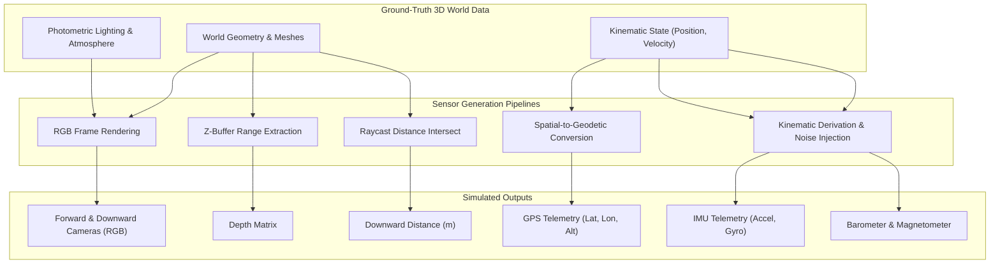

---

## 4. Camera & Observation System

The simulation environment maintains multiple decoupled viewport pipelines to serve both automated perception systems and human operators.

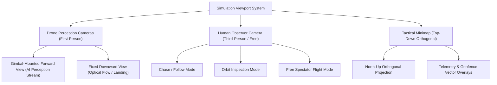

### 4.1 Drone Perception Cameras (First-Person)
- **Mounting Position:** Collocated with the visual gimbal payload on the drone model.
- **Field of View (FOV):** Standardized $90^\circ$ horizontal FOV (configurable between $60^\circ$ and $120^\circ$).
- **Gimbal Articulation:**
  - Pitch travel: $-90^\circ$ (straight down) to $+30^\circ$ (upward incline).
  - Yaw travel: $-180^\circ$ to $+180^\circ$ relative to airframe heading.
  - Automatic horizon stabilization: Configurable 2-axis stabilization (pitch/roll isolation) to emulate mechanical dampening.
- **Consumption:** This video stream is dedicated to synthetic sensor generation and computer vision ingestion.

### 4.2 Human Observer Camera (Third-Person / Free-Roam)
The human observer camera operates independently of the drone's sensory payload and does not perturb drone flight dynamics or AI inputs.

- **Mode 1: Chase / Follow Mode:**
  - Tracks the drone from a user-specified trailing distance (default: 5 meters behind, 2 meters above).
  - Smooth camera dampening with adjustable spring-arm stiffness to avoid jarring motion during rapid maneuvers.
- **Mode 2: Orbit / Inspection Mode:**
  - Centers on the drone's position while allowing the human user to orbit $360^\circ$ horizontally and $\pm 85^\circ$ vertically via mouse/keyboard controls.
- **Mode 3: Free-Flight / Spectator Mode:**
  - Completely detaches from the drone chassis.
  - Permits unconstrained translation across the entire 3D environment using standard directional controls (forward, backward, strafe, elevate, descend, pan, tilt).

### 4.3 Overhead Minimap & Tactical Display
A dedicated situational awareness display rendered in an auxiliary viewport or screen overlay:

- **Projection:** Orthographic top-down view centered on the operational area or tracking the drone, locked with True North facing upward.
- **Layer Overlays:**
  - **Drone Icon:** Current location marker with a direction vector indicating heading.
  - **Breadcrumb Trail:** Historical flight path line depicting traveled coordinates over the last $N$ minutes.
  - **Mission Flight Plan:** Target waypoints linked by planned trajectory lines, highlighting the active segment.
  - **Geofence Boundaries:** Distinct color-coded polygons delineating allowable flight corridors (green), warning buffers (amber), and strictly forbidden exclusion zones (red).
- **Scale & Interaction:** Adjustable zoom levels ($100\text{ m to }2,000\text{ m}$ viewport width) with auto-centering toggles.

---

## 5. Scene Configurations

The simulation environment must support hot-swapping between distinct, self-contained operational environments.

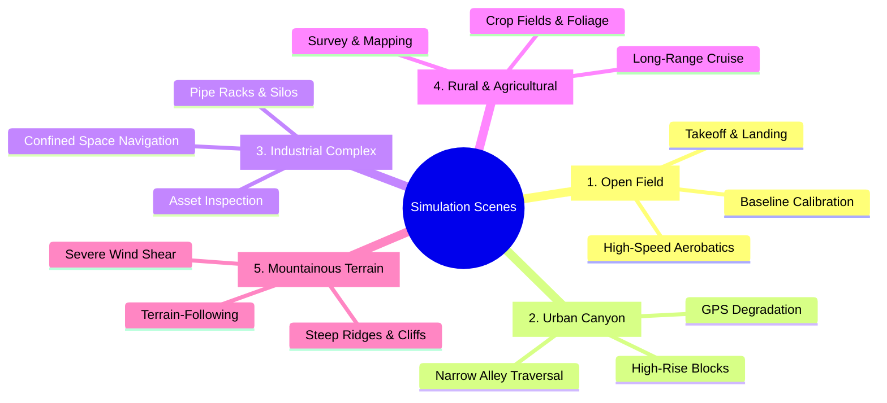

### 5.1 Scene Specification Catalog

| Scene Identifier | Dominant Features | Terrain Characteristics | Obstacle Density | Target Mission Profile |
|---|---|---|---|---|
| **`scene_open_field`** | Grassy plains, perimeter fences, lone trees, paved takeoff pad | Flat to gentle slope ($\le 3^\circ$ grade) | Very Low ($< 5\text{ obstacles/ha}$) | Baseline flight testing, airworthiness verification, speed trials |
| **`scene_urban_canyon`** | Paved streets, traffic lights, sidewalks, multi-story buildings ($10\text{ to }80\text{ m}$) | Flat asphalt grid | High ($> 50\text{ structures/ha}$) | Urban navigation, GPS-denied simulation, optical obstacle avoidance |
| **`scene_industrial`** | Steel framing, pipelines, chemical storage tanks, warehouses, cranes | Concrete pads, aggregate yards | High, complex irregular geometry | Close-range asset inspection, confined infrastructure navigation |
| **`scene_rural`** | Farmland, farm houses, tree stands, irrigation ditches, unpaved roads | Rolling hills ($5^\circ\text{ to }15^\circ$ grade) | Low to Medium | Orthomosaic aerial mapping, large-area perimeter patrol |
| **`scene_mountainous`** | Rocky peaks, steep drop-offs, deep valleys, sparse alpine vegetation | Severe relief ($0\text{ to }400\text{ m}$ elevation span) | Sparse natural rock formations | Terrain-following flight, altitude management, wind draft coping |

### 5.2 Scene Configuration Schema
Every scene must be defined by a structured configuration describing its initial environmental conditions:

```
SceneConfiguration {
    identifier: String
    displayName: String
    geographicOrigin: {
        latitude: Float (degrees)
        longitude: Float (degrees)
        altitudeEllipsoid: Float (meters)
    }
    terrain: {
        elevationModelSource: Path
        textureResolution: String
        navigableBounds: { minX: Float, maxX: Float, minY: Float, maxY: Float }
    }
    defaultSpawnPose: {
        x: Float, y: Float, z: Float
        heading: Float (degrees)
    }
    atmosphereDefaults: {
        timeOfDay: String ("HH:MM")
        solarZenith: Float (degrees)
        cloudCoverPercent: Integer (0..100)
        fogDistanceMeters: Float
        windVelocity: { speed: Float (m/s), direction: Float (degrees) }
    }
    structures: List<StructureDescriptor>
}
```

---

## 6. Performance & Execution Constraints

The 3D World must run deterministically alongside external simulators and control agents without inducing timing skew.

### 6.1 Performance Metrics

| Performance Metric | Target Specification | Minimum Acceptable Threshold | Measurement Context |
|---|---|---|---|
| **Human Observer Frame Rate** | $\ge 60\text{ FPS}$ | $\ge 30\text{ FPS}$ | 1920×1080 resolution on standard workstation hardware |
| **Sensor Generation Rate** | $\ge 30\text{ Hz}$ (cameras), $\ge 100\text{ Hz}$ (IMU) | Equal to simulator tick rate | Synchronous lockstep with flight controller |
| **Sensor End-to-End Latency** | $< 15\text{ ms}$ | $< 30\text{ ms}$ | Time elapsed from physical state ingest to sensor byte dispatch |
| **Scene Cold Loading Time** | $< 15\text{ seconds}$ | $< 30\text{ seconds}$ | Initialization time from disk to interactive ready state |
| **Memory Footprint** | $< 3.0\text{ GB}$ system RAM | $< 4.5\text{ GB}$ system RAM | Full scene loaded with all sensory buffers allocated |
| **GPU Memory (VRAM)** | $< 4.0\text{ GB}$ VRAM | $< 6.0\text{ GB}$ VRAM | High-resolution textures, shadow maps, and depth buffers |

### 6.2 Determinism and Co-Execution
- **Lockstep Stepping Capability:** The simulation loop must support discrete stepping mode (progressing world state by fixed $\Delta t$, e.g., $10\text{ ms}$ per tick) driven by the flight controller simulator to guarantee reproducible flight test logs.
- **Resource Coexistence:** The 3D World process must operate concurrently on a single physical host machine alongside:
  1. The flight controller simulator (SITL process).
  2. The drone communication gateway / MCP API server.
  3. The autonomous AI decision agent.
- **Priority Management:** Sensor frame generation must never stall the physics communication socket; if frame rendering experiences a transient hitch, the 3D World must continue reporting geometric ground truth and collision states on schedule.

---

## 7. Interface with External Systems

The 3D World maintains precise interface boundaries. It connects directly with the flight controller simulator and provides display viewports, but **never** exposes a direct communication channel to the autonomous AI agent.

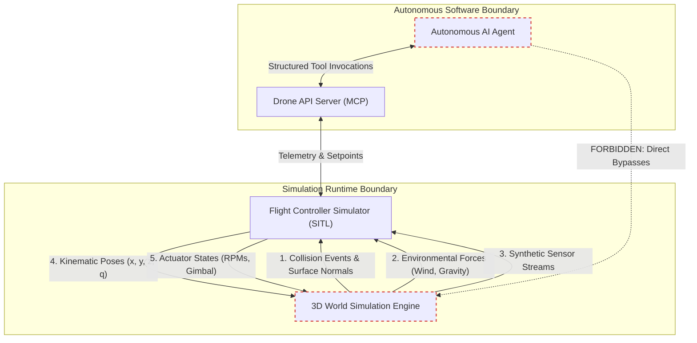

### 7.1 Data Exchanged: 3D World $\rightarrow$ Flight Controller Simulator
1. **Raw Sensor Streams:** Simulated raw bytes corresponding to optical frames, GPS NMEA/binary packets, IMU accelerometer/gyroscope measurements, and laser altimetry readings.
2. **Collision Events:**
   - Collision trigger (boolean).
   - Collision impact coordinate $(x, y, z)$ in world units.
   - Contact surface normal vector.
   - Estimated relative impact velocity vector.
3. **Local Environmental Quantities:** Ambient air temperature, local barometric pressure, air density, and spatial wind vector at current vehicle coordinates.

### 7.2 Data Exchanged: Flight Controller Simulator $\rightarrow$ 3D World
1. **Rigid Body Spatial Pose:** Instantaneous translation coordinates $(x, y, z)$ and orientation quaternion $(q_w, q_x, q_y, q_z)$.
2. **Body Linear & Angular Velocities:** $(v_x, v_y, v_z)$ and $(p, q, r)$ for accurate camera motion blur and propeller aerodynamic rendering.
3. **Actuator States:** Individual motor rotation rates (RPMs) for rotor visualization.
4. **Gimbal Positioning Commands:** Commanded pitch, roll, and yaw angles for the optical payload assembly.

### 7.3 Compliance with Drone API
All autonomous mission commands (e.g., `takeoff`, `goto_location`, `return_to_launch`, `set_gimbal_angle`) are issued by the AI Agent to the Drone API. The Drone API commands the Flight Controller Simulator, which in turn commands the visual drone in the 3D World.

For the formal definition of flight commands, telemetry formats, and tool contracts exposed to the AI agent, see the [Drone API Specification](drone-api.md).

---

## 8. Verification & Acceptance Criteria

Every functional requirement defined in this specification must be verifiable through automated or repeatable visual test procedures.

### 8.1 Verification Test Matrix

| Req ID | Requirement Area | Verification Method | Acceptance Pass Criteria |
|---|---|---|---|
| **V-01** | Minimum Terrain Extent | Automated Geometry Test | Navigable boundary geometry measures $\ge 1,000\text{ m} \times 1,000\text{ m}$ continuous terrain without voids. |
| **V-02** | Collision Enforcement | Automated Penetration Test | Drone collision hull commanded to drive into building, ground, and tree trunk objects triggers a collision event at distance $\le 0.05\text{ m}$ from surface; penetration beyond surface is prevented. |
| **V-03** | Sensor Update Frequency | Continuous Sampling Test | Forward camera produces $\ge 15\text{ FPS}$ sustained; IMU stream sustains $\ge 50\text{ Hz}$ without dropped samples over a 10-minute flight. |
| **V-04** | Sensor Noise Profile | Statistical Distribution Test | Simulated GPS readings centered around ground truth exhibit Gaussian dispersion matching specified standard deviation ($\sigma \le 1.5\text{ m}$). |
| **V-05** | Diurnal Cycle Fidelity | Visual / Radiometric Ingest | Solar elevation matches astronomical calculations for specified latitude and time; ambient Lux scales monotonically between noon and midnight. |
| **V-06** | Observer Camera Independence | Viewport Concurrency Test | Moving, zooming, or detaching the human observer camera causes zero deviation ($0.0\%$ variance) in the forward camera frames delivered to the perception stream. |
| **V-07** | Scene Switch Performance | Automated Benchmark | Transitioning from `scene_open_field` to `scene_urban_canyon` completes and enters active simulation loop within $< 30\text{ seconds}$. |
| **V-08** | Frame Rate Stability | Stress Benchmark | Running `scene_industrial` with dynamic lighting maintains an observer viewport render rate $\ge 30\text{ FPS}$ while concurrently streaming all sensor feeds. |
| **V-09** | Decoupled Architecture | Protocol Audit | Verification that no direct communication sockets or shared memory handles exist between the autonomous AI agent process and the 3D World process. |
