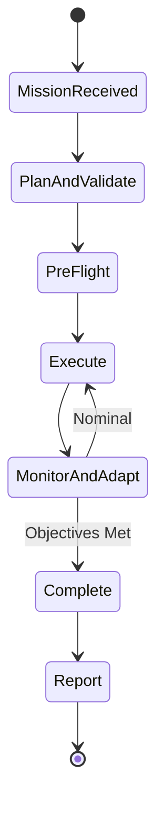

# AI Agent Specification

## 1. Purpose

The autonomous AI agent receives high-level mission objectives and executes them by controlling a drone through the Model Context Protocol (MCP) interface. 

The agent reasons about the drone's state, analyzes camera imagery, and makes decisions about navigation, inspection, and safety. Furthermore, the agent communicates with humans through natural language (chat) to clarify goals, report progress, and seek approval.

The agent is model-agnostic: any AI model that supports tool-calling and vision capabilities can serve as the reasoning engine for the system.

## 2. Agent Architecture

### 2.1 Cognitive Layer (The AI Agent)

The cognitive layer acts as the strategic brain of the system.
- **Operating Frequency:** 0.05-0.5 Hz (one decision every 2-20 seconds).
- **Inputs Received:** Mission objectives (natural language), drone telemetry (structured data), camera frames (images).
- **Outputs Produced:** Drone commands (MCP tool calls), status reports (natural language), alert responses.
- **Constraint:** This is the ONLY layer that employs artificial intelligence or machine learning models.

### 2.2 What the Agent Does NOT Do

The agent is a strategic planner, not a flight controller. It delegates real-time control and safety execution to the underlying flight system:
- **Flight Dynamics:** Does NOT control motors, attitude, or flight dynamics (handled by the flight controller at 100-400 Hz).
- **Collision Avoidance:** Does NOT run real-time obstacle avoidance (handled by the flight controller).
- **Video Streaming:** Does NOT process continuous video streams (receives discrete keyframes and snapshots).

### 2.3 System Boundary Diagram

```mermaid
graph TD
    subgraph Cognitive Layer [Cognitive Layer: AI Agent]
        A[Mission Planning]
        B[Visual Reasoning & Analysis]
        C[Strategic Decision Making]
        D[Human-Agent Communication]
    end

    subgraph Flight System [Flight System: Flight Controller]
        E[Real-time Motor Control]
        F[Attitude & Flight Dynamics]
        G[Real-time Obstacle Avoidance]
        H[Hardware Failsafes]
    end

    Cognitive Layer -- High-level Commands & Waypoints --> Flight System
    Flight System -- Telemetry & Snapshots --> Cognitive Layer
```

## 3. Mission Lifecycle

The mission follows a strict sequence from receipt to completion.



### 3.1 Mission Receipt
- **Input:** Human provides a goal in natural language (e.g., "Inspect the solar panels on the east building").
- **Processing:** Agent parses the intent, extracting the primary action, location, and constraints.
- **Output:** Agent asks clarifying questions if the goal is ambiguous or lacks required constraints.

### 3.2 Planning
- **State Gathering:** Agent reads current drone state via MCP resources.
- **Decomposition:** Decomposes the mission into a sequence of sub-goals (e.g., takeoff → navigate to building → orbit at inspection altitude → capture images → return home → land).
- **Feasibility Check:** Estimates feasibility (e.g., sufficient battery, within geofence, acceptable weather).
- **Approval:** Presents the plan to the human for approval, unless operating in fully autonomous mode.

### 3.3 Pre-Flight
- **Action:** Calls `run_preflight_check` tool.
- **Evaluation:** Evaluates results for sensor health, GPS fix quality, and battery sufficiency.
- **Decision:** Determines go/no-go status based on pre-flight results.

### 3.4 Execution
- **Action:** Executes sub-goals sequentially by calling appropriate MCP tools.
- **Verification:** After each tool call, reads relevant telemetry to verify the requested action was successfully completed.
- **Monitoring:** Monitors for deviations from the planned trajectory or state.

### 3.5 Monitoring & Adaptation
The agent continuously (at its operating frequency) assesses the state of the system:
- **Battery Management:** Monitors battery level. Triggers Return-to-Launch (RTL) if below the safety threshold.
- **GPS Quality:** Monitors GPS fix. Alerts if signal degrades.
- **Sensor Health:** Monitors sensor status. Alerts if any sensor fails.
- **Visual Analysis:** Analyzes camera frames to identify targets of interest, obstacles, or anomalies.
- **Mission Progress:** Evaluates if the drone is on track to complete the objectives.

If unexpected conditions arise, the agent re-plans:
- **Obstacle:** Reroutes to avoid.
- **Target Found:** Pauses to inspect.
- **Low Battery:** Shortens mission and initiates return.
- **Weather Change:** Aborts mission if conditions become unsafe.

### 3.6 Completion & Reporting
- **Confirmation:** Agent confirms all mission objectives are met, or provides a detailed explanation of why they were not.
- **Return:** Commands the drone to return home and land.
- **Summary:** Generates a comprehensive mission summary detailing flight duration, distance flown, key findings, captured images, and any alerts encountered.

## 4. Vision Pipeline

The agent utilizes visual data to inform strategic decisions.

### 4.1 Frame Acquisition
- **Mechanism:** Agent reads camera frames via the `drone://camera/snapshot` resource.
- **Cadence:** Frames are acquired on-demand, not streamed. The agent dictates the acquisition cadence.
- **Typical Usage:** Every 2-5 seconds during active inspection, and selectively during transit.

### 4.2 Scene Understanding
The agent analyzes each frame to extract semantic understanding:
- **Object Detection:** Identifies buildings, vehicles, people, equipment, and terrain features.
- **Spatial Layout:** Estimates distances, sizes, and relative positions of objects.
- **Anomaly Detection:** Identifies targets of interest such as structural damage, leaks, heat signatures, or unusual patterns.
- **Hazard Identification:** Detects obstacles in the flight path, moving objects, or restricted operational areas.

### 4.3 Visual Decision Making
Based on the extracted scene understanding, the agent transitions to new states or actions:
- Adjusts altitude or camera angle for an optimized view.
- Moves closer to inspect a detected anomaly.
- Captures additional images from diverse angles.
- Flags findings for human review.
- Reroutes the flight path to avoid visually detected obstacles.

### 4.4 Depth Analysis
- **Mechanism:** Agent reads depth maps via the `drone://camera/depth` resource.
- **Application:** Uses depth data to estimate precise distances to objects.
- **Decision Impact:** Informs navigation decisions to ensure adequate clearance from structures and maintain safe inspection distances.

## 5. Telemetry Analysis

The agent continuously assesses system health and status.

### 5.1 Battery Management
- **Tracking:** Tracks remaining battery percentage and estimated remaining flight time.
- **Calculation:** Continuously calculates the battery required to return to the launch point from the current spatial position.
- **Thresholds:**
  - **< 50%:** Shorten mission scope, prioritize critical objectives.
  - **< 25%:** Initiate Return-to-Launch (RTL).
  - **< 15%:** Immediate RTL regardless of mission state or location.
  - **< 10%:** Emergency land (executed by the flight controller, not the agent).

### 5.2 GPS Quality Assessment
- **Monitoring:** Monitors satellite count, fix type, and accuracy metrics (e.g., HDOP).
- **Behavioral Degradation:**
  - **RTK fixed:** Highest confidence, full operational speed.
  - **3D fix with good HDOP:** Normal operations.
  - **3D fix with poor HDOP:** Reduce transit speed, increase safety buffers.
  - **2D fix or no fix:** Hold position, alert human operator, evaluate mission abort.

### 5.3 Sensor Health Monitoring
- **Monitoring:** Checks all sensor statuses via `drone://telemetry/sensors`.
- **Failure Responses:**
  - **IMU failure:** Immediate emergency land (handled by flight controller).
  - **GPS failure:** Hold position, switch to conservative operation mode.
  - **Compass failure:** Reduce reliance on absolute heading, utilize GPS track data.
  - **Camera failure:** Abort visual missions, report failure, initiate return.
  - **Barometer failure:** Rely on GPS altitude, reduce altitude precision requirements.

## 6. Decision-Making Patterns

The agent applies strict logic to determine mission state transitions.

### 6.1 When to Continue
- All critical systems are nominal.
- Battery is sufficient for mission completion plus the required RTL reserve.
- GPS quality meets minimum operational thresholds.
- No safety alerts are currently active.
- Primary mission objectives remain incomplete.

### 6.2 When to Reroute
- An obstacle is detected in the currently planned flight path.
- Wind conditions render the planned approach vector unfavorable or unsafe.
- The target is not found at the expected location, necessitating a search pattern.
- A superior vantage point is identified during visual analysis.

### 6.3 When to Abort
- Battery level drops below the safe return threshold.
- A critical sensor fails.
- GPS quality degrades beyond safe navigation parameters.
- A geofence breach is imminent.
- The human operator explicitly requests an abort.
- Weather conditions deteriorate rapidly.

### 6.4 When to Request Human Input
- The operational situation is ambiguous (e.g., unclear if a detected target matches mission criteria).
- A safety-critical decision is required with no clear optimal automated option.
- The mission cannot be completed as originally specified, and alternatives must be proposed.
- An unexpected finding alters the initial mission priorities.

## 7. Fallback Behaviors

The system must handle disruptions in the cognitive layer gracefully.

### 7.1 AI Model Unavailable
- **Scenario:** The AI model cannot be reached (e.g., cloud outage, API timeout).
- **Behavior:**
  - The drone continues its current immediate action until completion (e.g., finishes navigating to the current waypoint).
  - The drone then holds position and waits for reconnection.
  - If no reconnection occurs within a configurable timeout period, the drone initiates RTL.
  - The human operator is alerted immediately.

### 7.2 Unexpected Situations
- **Unknown Object:** If an unknown object blocks the path, the drone must stop, hover, capture an image, and request human input.
- **Kinematic Mismatch:** If the drone behaves unexpectedly (e.g., position remains static despite movement commands), the agent must pause operations, diagnose the discrepancy, and report.
- **Sensor Conflict:** If sensor data is conflicting, the agent must reduce confidence scores, increase safety margins, and alert the human operator.

### 7.3 Communication Loss with Drone
- **Scenario:** The MCP connection to the drone drops.
- **Behavior:**
  - Agent reports the communication loss to the human operator immediately.
  - The flight controller's internal failsafe mechanisms take over (typically hold position, followed by RTL).
  - The agent continuously monitors the connection for reconnection.
  - The disconnection event is persistently logged.

## 8. Model-Agnostic Interface

The agent specification defines functional capabilities, not specific model requirements. The system architecture supports swapping reasoning models provided they meet the following capabilities:

| Capability | Requirement |
|---|---|
| **Tool Calling** | Must invoke MCP tools with structured, valid parameters. |
| **Vision** | Must analyze and interpret image inputs (camera frames, depth maps). |
| **Structured Output** | Must return decisions and rationales in a consistently parseable format. |
| **Context Management** | Must maintain mission state and history across multiple interaction turns. |
| **Reasoning** | Must decompose complex goals, evaluate operational trade-offs, and handle uncertainty. |

## 9. Logging & Observability

Comprehensive observability is required for post-mission analysis and system improvement.
- **Action Logging:** Every tool call made by the agent is logged with a precise timestamp, parameters, and execution result.
- **Reasoning Tracing:** Every strategic decision includes a natural language explanation documenting the agent's reasoning process.
- **Visual Archiving:** Camera frames that directly influenced a decision are archived for review.
- **Telemetry Snapshots:** Complete telemetry snapshots at the exact moment of critical decisions are archived.
- **Purpose:** These logs enable thorough post-mission analysis, system debugging, and the generation of training data for future improvements.

---
See [Drone API Spec](drone-api.md) for the complete tool and resource interface.
See [User Interface Spec](user-interface.md) for how the agent communicates with humans.
