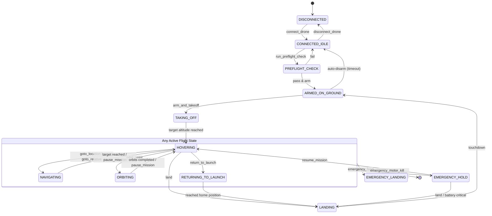

# Drone API Specification

## 1. Purpose
Define the standard interface through which an AI agent (or any external consumer) controls a drone and reads its state. This interface is identical whether the drone is simulated or physical. It uses the Model Context Protocol (MCP) standard consisting of Tools (actions), Resources (data), and Prompts (workflows). It acts as a safety-enforcing middleware between the AI agent and the flight system.

## 2. Connection Model
The API connects to a drone through a connection address (URI string). The connection address abstracts whether the target is a simulator or physical hardware.
- Only one active connection is permitted per API instance (Phase 1).
- **Connection lifecycle:** connect → verify heartbeat → ready → operate → disconnect.

## 3. MCP Tools (Actions)
Tools represent the actionable commands the AI agent can issue. Each tool defines specific inputs and outputs.

### Connection & Setup
- `connect_drone`: Establish a connection to the drone using a connection address.
  - **Output:** Connection status, drone identification.
- `disconnect_drone`: Gracefully close the drone connection.

### Pre-Flight
- `run_preflight_check`: Validates all systems including sensors, GPS fix quality, battery level, and compass calibration.
  - **Output:** A checklist with pass/fail per item, and an overall readiness verdict.

### Flight Actions
- `arm_and_takeoff`: Arms motors and ascends to a specified altitude (meters Above Ground Level).
  - **Input:** `target_altitude` (1-120m).
  - **Constraints:** Requires preflight check to have passed.
  - **Output:** Success/failure, current altitude.
- `land`: Initiates landing at the current position.
  - **Output:** Touchdown confirmation.
- `return_to_launch`: Flies back to the takeoff location and lands automatically.
  - **Output:** ETA, distance remaining.
- `goto_location`: Navigate to specified geographic coordinates.
  - **Input:** `latitude`, `longitude`, `altitude` (Above Mean Sea Level), optional `ground_speed` (max 15 m/s).
  - **Output:** ETA, distance.
- `goto_relative`: Navigate relative to the current position.
  - **Input:** Forward, right, and up offsets in meters, optional speed.
  - **Output:** ETA.
- `orbit_point`: Circle a specific point of interest.
  - **Input:** Center lat/lon, radius (5-100m), altitude, direction (clockwise/counter-clockwise), optional number of orbits.
  - **Output:** Progress.
- `set_heading`: Rotate the drone to face a specific compass heading.
  - **Input:** `heading` (0-360 degrees).
  - **Output:** Current heading.
- `pause_mission`: Hold position and hover in place.
  - **Output:** Hold coordinates.
- `resume_mission`: Continue previously paused navigation.
  - **Output:** Next waypoint info.

### Camera & Gimbal
- `set_gimbal_angle`: Set camera gimbal pitch and yaw.
  - **Input:** `pitch` (-90 to +20 degrees), `yaw` (-180 to +180 degrees).
  - **Output:** Actual angles achieved.
- `capture_image`: Take a snapshot from the drone camera.
  - **Output:** Image data, timestamp, GPS coordinates, altitude, gimbal angles.
- `start_video_stream`: Begin continuous video streaming.
  - **Output:** Stream identifier.
- `stop_video_stream`: End video streaming.

### Emergency
- `emergency_stop`: Immediately halt all movement and hover in place. Overrides any active navigation.
- `emergency_land`: Force an immediate landing at the current position regardless of conditions.
- `emergency_motor_kill`: **CRITICAL** — Cut all motors immediately.
  - **Input:** Explicit confirmation code.
  - **Constraints:** Use only when collision is imminent and controlled flight is impossible.

## 4. MCP Resources (Read-Only Data)
Resources are URI-addressable, read-only data feeds representing the state of the drone and its environment.

- `drone://status/connection`: Connection state, drone ID, firmware version, uptime.
- `drone://telemetry/position`: Latitude, longitude, altitude (AMSL and AGL), heading, ground speed, vertical speed, climb rate.
- `drone://telemetry/attitude`: Roll, pitch, yaw (degrees), angular rates.
- `drone://telemetry/battery`: Voltage, current draw, remaining percentage, estimated flight time remaining, cell count, temperature.
- `drone://telemetry/gps`: Fix type (none/2D/3D/RTK), satellite count, horizontal/vertical accuracy (HDOP/VDOP), position age.
- `drone://telemetry/sensors`: Health status of each sensor (IMU, compass, barometer, GPS, rangefinder, optical flow). Reports: present, enabled, healthy, last reading timestamp.
- `drone://telemetry/wind`: Estimated wind speed and direction (if available).
- `drone://camera/snapshot`: Latest camera frame with metadata (timestamp, GPS, altitude, gimbal angles).
- `drone://camera/depth`: Latest depth map from the forward camera.
- `drone://mission/state`: Current mission state, active command, progress percentage, time elapsed.
- `drone://safety/geofence`: Active geofence boundaries (polygon vertices), maximum altitude ceiling, minimum altitude floor.
- `drone://safety/alerts`: Active alert list with severity (info/warning/critical) and descriptions.

## 5. MCP Prompts (Workflow Templates)
Parameterized prompt templates for common operational workflows used by the AI agent:

- `preflight_checklist`: Step-by-step pre-flight inspection procedure.
- `survey_area`: Template for a systematic area survey (inputs: polygon boundary, altitude, overlap percentage).
- `inspect_target`: Template for inspecting a point of interest (inputs: target coordinates, inspection distance, angles).
- `search_pattern`: Template for search-and-find missions (inputs: search area, pattern type: grid/spiral/expanding-square).
- `low_battery_procedure`: Decision tree for managing low battery situations.
- `lost_connection_procedure`: Steps to take when communication with the AI agent is interrupted.

## 6. Drone State Machine
The drone operates as a deterministic finite state machine.



**Key rules:**
- Cannot arm without passing the preflight check.
- Cannot navigate without first taking off.
- Emergency states are reachable from any active flight state.
- Landing always transitions to `ARMED_ON_GROUND` → auto-disarm → `CONNECTED_IDLE`.
- **Timeouts:** If no command is received for 30 seconds while `HOVERING`, a low-priority alert is triggered.

## 7. Safety Architecture
A four-tier defense in depth ensures secure and stable operations.

**Tier 4 — AI Reasoning Constraints**
- The AI agent's system prompt includes strict safety rules.
- The agent is instructed to never issue commands that conflict with safety parameters.
- *Note:* This is the weakest tier and can be overridden by model errors.

**Tier 3 — API Middleware Validation**
- Every tool call passes through validation before reaching the flight system.
- Parameter range checks (e.g., altitude within bounds, speed within limits).
- Geofence validation (destination must be inside allowed boundaries).
- State machine guard validation (command must be valid for current state).
- Battery reserve check (rejects navigation if insufficient battery remains for RTL).
- Rate limiting to prevent command flooding.
- Returns descriptive error messages when validation fails.

**Tier 2 — Flight Controller Failsafes**
- Embedded directly in the flight controller firmware.
- Battery low triggers automatic RTL.
- Battery critical triggers automatic land.
- Communication loss triggers position hold, then RTL after a timeout.
- GPS loss triggers a switch to position hold using alternative sensors.
- Maximum altitude ceiling is enforced regardless of external commands.
- These failsafes cannot be overridden by the API.

**Tier 1 — Physical Safety / Human Override**
- Hardware kill switch.
- Manual remote controller override.
- Physical range limitations.
- These operate entirely outside the software system.

## 8. Error Handling
Every tool call returns a structured JSON response.

```json
{
  "status": "success | rejected | failed | in_progress",
  "message": "Human-readable description",
  "data": { 
    "...": "tool-specific response data" 
  },
  "errors": [ 
    { "code": "...", "detail": "..." } 
  ]
}
```

**Error Categories:**
- `VALIDATION_ERROR`: Invalid parameters provided.
- `STATE_ERROR`: Command is not valid in the current drone state.
- `SAFETY_VIOLATION`: Geofence, altitude, or battery constraint violated.
- `HARDWARE_ERROR`: Sensor failure, motor issue, communication loss.
- `TIMEOUT`: Operation did not complete within the expected time window.

## 9. Telemetry Update Model
- Resources are point-in-time snapshots. They are read when needed by the agent and are not continuously streamed to the agent prompt.
- The API emits asynchronous event notifications for critical state changes:
  - Battery crossed a threshold (50%, 25%, 10%).
  - Entered or exited a geofence warning zone.
  - Sensor health changed (sensor failed or recovered).
  - State machine transition occurred.
  - Collision proximity alert (obstacle within critical distance).
- This hybrid model prevents overwhelming the AI agent with continuous data while ensuring critical events are never missed.

## 10. Connection Abstraction
The API presents an identical interface regardless of the underlying drone.

| Aspect | Simulated Drone | Physical Drone |
|---|---|---|
| **Connection address** | Points to local simulator process | Points to hardware serial/radio link |
| **Sensor data** | Generated by 3D world + physics simulator | Read from physical sensors |
| **Command execution**| Processed by simulator | Transmitted to physical flight controller |
| **Latency** | Near-zero | Variable (20-300ms typical) |
| **GPS availability** | Instant fix | Requires satellite acquisition (60-180s cold start) |
| **Environmental factors**| Simulated wind model | Real atmospheric conditions |

The API handles these differences internally. The AI agent's tool calls and resource reads are structurally and functionally identical in both scenarios.

---
**References:**
- See [AI Agent Spec](ai-agent.md) for how the agent consumes this interface.
- See [3D World Spec](3d-world.md) for how the simulator generates sensor data.
