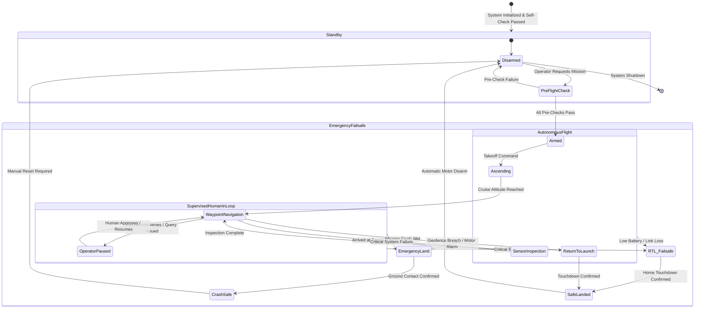

# Autonomous Drone Simulation System — Project Overview Specification

| Document Attribute | Specification Detail |
| :--- | :--- |
| **Document Identifier** | SPEC-000 |
| **Title** | Autonomous Drone Simulation System — Project Overview |
| **Document Version** | 1.0.0 |
| **Status** | Approved Architecture Baseline |
| **Target Audience** | System Architects, Product Managers, Test Engineers, Subsystem Implementers |

---

## 1. Project Vision

The Autonomous Drone Simulation System establishes an integrated platform wherein an intelligent autonomous agent perceives, reasons about, and navigates through a high-fidelity simulated three-dimensional environment. The system addresses the challenges of mission planning, spatial comprehension, automated aerial execution, and human-machine collaboration under rigorous safety constraints.

```
       +-----------------------------------------------------------+
       |                     HUMAN OPERATOR                        |
       |     Natural Language Chat  |  Visual Telemetry Dashboard  |
       +-----------------------------+-----------------------------+
                                     |
                                     v
       +-----------------------------------------------------------+
       |                 AUTONOMOUS AI AGENT                       |
       |         Perception  ->  Reasoning  ->  Planning           |
       +-----------------------------+-----------------------------+
                                     |
                                     v
       +-----------------------------------------------------------+
       |               UNIVERSAL DRONE API (MCP)                   |
       |      Action Execution  |  Telemetry  |  Safety Enforcer   |
       +--------------+-----------------------------+--------------+
                      |                             |
                      v                             v
       +-----------------------------+ +---------------------------+
       |    SIMULATED 3D WORLD       | |    PHYSICAL DRONE         |
       |  Physics, Environment,      | |  Hardware Flight System   |
       |  Virtual Sensors (Camera)   | |  (Identical API Contract) |
       +-----------------------------+ +---------------------------+
```

### 1.1 Core Objectives
1. **Autonomous Closed-Loop Operation**: The AI agent functions within a continuous observe-orient-decide-act (OODA) cycle, consuming sensor feeds and vehicle telemetry, forming structured plans, and executing precise flight actions without requiring continuous manual flight piloting.
2. **First-Class Simulation Parity**: The system provides complete behavioral and functional parity between simulated flight and physical flight. The exact same AI agent, API interfaces, safety envelopes, and telemetry channels govern both virtual drones and physical hardware. The AI agent operates without awareness of whether the controlled vehicle is simulated or physical.
3. **Multi-Modal Human Supervision**: Human operators supervise operations through three operational paradigms:
   - **Conversational Interface**: Direct natural-language instruction, dynamic status querying, and collaborative re-planning.
   - **Visual Dashboard**: Real-time 3D spatial visualization, flight telemetry instruments, geospatial map overlays, and manual override controls.
   - **Autonomous Supervised Execution**: Autonomous execution within predefined safety envelopes, delegating flight path synthesis and collision avoidance to the agent while preserving immediate human intervention authority.

---

## 2. System Architecture

The system comprises four decoupled subsystems that interact exclusively across strictly defined interfaces.

```mermaid
flowchart TB
    subgraph SubsystemD["Subsystem D: User Interface"]
        UI_Chat["Natural Language Chat Panel"]
        UI_WorldView["3D Viewport & Scene Monitor"]
        UI_Telem["Telemetry & Sensor Instruments"]
        UI_Override["Safety & Manual Override Controls"]
    end

    subgraph SubsystemC["Subsystem C: AI Agent"]
        Agent_Reasoner["Perception & Cognitive Planner"]
        Agent_Memory["Mission State & Spatial Context"]
        Agent_SafetyMonitor["Agent-Side Safety Validator"]
    end

    subgraph SubsystemB["Subsystem B: Drone API (MCP Interface)"]
        API_Tools["Executable Flight Tools"]
        API_Resources["Read-Only Telemetry Resources"]
        API_Prompts["Standardized Mission Prompts"]
        API_Safety["Autonomous Safety & Geofence Enforcer"]
    end

    subgraph SubsystemA["Subsystem A: Interactive 3D World"]
        World_Physics["Physics & Aerodynamics Engine"]
        World_Env["Terrain, Obstacles, Weather & Illumination"]
        World_Sensors["Simulated Cameras & Range Sensors"]
        World_State["Vehicle Kinematics & Coordinate System"]
    end

    subgraph ExternalPhysical["Physical Target (Hardware Parity)"]
        Phys_Vehicle["Physical Drone Hardware"]
        Phys_Sensors["Onboard Physical Sensors"]
    end

    %% User Interface Interactions
    UI_Chat <-->|"Natural Language Directives & Explanations"| SubsystemC
    UI_Override ==>|"Immediate Halt / Emergency Override"| API_Safety
    API_Resources -->|"Telemetry Stream"| UI_Telem
    World_Env -->|"Rendering Pipeline"| UI_WorldView
    World_Sensors -->|"Simulated Video Stream"| UI_WorldView

    %% AI Agent Interactions with API
    Agent_Reasoner -->|"Invoke Flight Tools"| API_Tools
    API_Resources -->|"Telemetry Snapshots & State"| Agent_Reasoner
    API_Prompts -->|"Operational Workflows"| Agent_Reasoner
    World_Sensors -.->|"Camera Frames & Depth Maps"| Agent_Reasoner

    %% API to World / Physical
    API_Safety -->|"Validated Flight Commands"| World_Physics
    World_State -->|"Kinematic State Data"| API_Resources
    API_Safety -.->|"Hardware Control Link (Parity Target)"| Phys_Vehicle
    Phys_Sensors -.->|"Physical Telemetry"| API_Resources
```



### 2.1 Subsystem Decomposition

#### Subsystem A: Interactive 3D World
The simulated environment provides deterministic spatial, aerodynamic, and environmental modeling.
- **Physical Dynamics**: Models rigid-body aerodynamics, gravitational acceleration, rotor thrust dynamics, ground effects, drag, inertia, and physical collision bounding volumes.
- **Environmental Context**: Provides procedural or defined terrain elevations, structural obstacles (buildings, towers, utility poles, foliage), customizable weather conditions (wind vectors, gust turbulence, precipitation, fog density), and dynamic daylight/solar azimuth modeling.
- **Simulated Sensor Synthesis**: Generates real-time synthetic sensor feeds, including visual RGB cameras with controllable optical zoom, depth matrices, global position coordinates, barometric altitude estimates, inertial measurement unit (IMU) data, and orientation quaternions.
- **Reference**: Detailed behavioral requirements, physics fidelity parameters, and coordinate reference frames are specified in [3D World Spec](3d-world.md).

#### Subsystem B: Drone API (Model Context Protocol Interface)
The universal abstraction boundary mediating all control and observation commands between higher-level intelligence and vehicle hardware/simulation engines.
- **Standardized MCP Tool Expositions**: Exposes deterministic, atomic, parameterized flight actions (e.g., arm, takeoff, navigate to coordinates, change speed, hold position, point camera gimbal, land).
- **Read-Only Telemetry Resources**: Exposes continuous and polled telemetry feeds (battery charge state, current spatial coordinates, linear velocities, angular orientations, flight mode, geofence margins).
- **Workflow Prompts**: Supplies parameterized operational mission patterns (e.g., perimeter survey, waypoint sweep, search pattern, asset orbit).
- **Safety Enforcement Barrier**: Performs real-time constraint validation on all proposed commands prior to dispatching them to the flight execution layer. Rejects out-of-boundary requests, invalid flight envelopes, or depleted battery trajectories.
- **Reference**: Tool signatures, resource endpoints, parameter validation rules, and error return types are specified in [Drone API Spec](drone-api.md).

#### Subsystem C: AI Agent
The autonomous cognitive unit responsible for goal translation, spatial understanding, and closed-loop flight execution.
- **Natural Language Parsing**: Accepts unstructured or semi-structured mission requirements from human supervisors and translates them into actionable topological goal sets.
- **Visual Scene Understanding**: Evaluates raw camera imagery and synthetic sensor data to classify objects of interest, confirm landing zone viability, detect unmapped dynamic obstacles, and verify target localization.
- **Plan Synthesis & Tool Invocation**: Formulates sequential and branch-capable flight plans, executing calls against Subsystem B's MCP tool set while inspecting action completion receipts.
- **Contingency Management**: Dynamically reassesses mission plans upon encountering unexpected environmental variations, tool execution failures, telemetry anomalies, or visual obstructions.
- **Reference**: Cognitive state machines, tool orchestration flows, perception requirements, and re-planning algorithms are specified in [AI Agent Spec](ai-agent.md).

#### Subsystem D: User Interface
The unified operational dashboard enabling human operators to observe, direct, and intervene in system operations.
- **Conversational Operator Panel**: Dual-channel chat interface enabling the user to submit taskings, receive progress updates, review visual observation summaries, and query flight justification records.
- **3D Spatial Visualization**: Real-time visual perspective showing the drone's position, planned trajectory splines, spatial bounding boxes, sensor frustums, and rendered environment.
- **Flight Instrument Gauges**: Visual telemetry readouts presenting altitude (AGL and AMSL), horizontal/vertical velocity vectors, battery consumption rates, link status, and geofence margins.
- **Override Mechanisms**: Hardwired, high-priority manual controls allowing immediate flight cancellation, emergency landing, return-to-launch trigger, or manual flight controller take-over.
- **Reference**: Layout configurations, telemetry presentation standards, control latency budgets, and override behaviors are specified in [User Interface Spec](user-interface.md).

---

### 2.2 Subsystem Interface Boundaries

The following interface matrix governs data and control flow across system boundaries:

| Interface Path | Direction | Nature of Communication | Payload Contents |
| :--- | :--- | :--- | :--- |
| **Operator $\leftrightarrow$ Agent** | Bi-directional | Natural language text & structured status events | Mission directives, queries, clarifications, execution reports, rationale narratives |
| **Agent $\rightarrow$ API (Tools)** | Unidirectional | Structured command execution requests | Tool names, parameter dictionaries, execution preconditions, timeout limits |
| **API $\rightarrow$ Agent (Resources)** | Unidirectional | Telemetry snapshots, event notifications | Coordinate states, battery percentages, flight modes, tool execution results/errors |
| **API $\leftrightarrow$ 3D World / Hardware** | Bi-directional | Low-level control setpoints & telemetry streams | Attitude targets, velocity vectors, motor commands, raw state vectors, GPS signals |
| **3D World $\rightarrow$ Agent** | Unidirectional | Visual & spatial perception feeds | Synthetic RGB video frames, depth maps, detection metadata |
| **3D World $\rightarrow$ UI** | Unidirectional | Environmental graphics & spatial scene state | Render frames, camera viewpoints, active obstacle geometry |
| **Operator $\rightarrow$ API (Override)** | Unidirectional | High-priority pre-emptive safety commands | Emergency stop, Return-to-Launch, Land Immediately, Geofence Overwrite |

---

## 3. Design Principles

Every subsystem and component must adhere to six architectural design principles:

### 3.1 Strict Decoupling
Subsystems interact solely through formal, versioned interface specifications. 
- No subsystem may maintain internal assumptions regarding the internal implementation, memory layout, or storage model of any other subsystem.
- Any subsystem (such as replacing the 3D World simulator with a physical vehicle bridge, or replacing the Agent cognitive model) can be substituted without modifying a single line of interface code in the remaining subsystems.

### 3.2 Simulation Parity
Simulation parity is a mandatory system constraint.
- The Drone API exposes an indistinguishable functional interface regardless of whether the execution backend is the 3D World physics simulator or physical flight control hardware.
- The AI Agent receives identical telemetry schemas, timing constraints, coordinate systems, and tool responses in both simulation and real-world execution.
- No simulator-specific "shortcuts" or "cheats" (e.g., reading exact obstacle coordinates from simulation scene trees instead of visual sensor feeds) are accessible to the AI agent.

### 3.3 Safety by Default
The system enforces defensive architecture at every tier:
- **Defense in Depth**: Safety constraints are validated at multiple autonomous levels: first by the AI Agent before proposing an action, second by the Drone API prior to executing any command, and third by internal failsafe routines operating at the flight dynamics layer.
- **Deterministic Precedence**: Human safety overrides and automated failsafe triggers instantly supersede any active AI agent command or mission sequence.
- **Fail-Safe Default State**: In the event of communication disruption, telemetry loss, software crash, or battery exhaustion, the vehicle immediately enters an autonomous failsafe state (hover in place, return to launch, or controlled vertical landing).

### 3.4 Model Agnosticism
The AI agent architecture does not depend on any proprietary model provider, specific neural architecture, or proprietary vendor runtime.
- The cognitive interface requires only standard structured tool-calling capabilities and image/text multimodal comprehension.
- Switching between different foundation language models or localized reasoning engines requires no modifications to the Drone API or User Interface subsystems.

### 3.5 Framework Agnosticism
All specifications describe operational behavioral contracts, inputs, outputs, states, and constraints rather than programming language idioms or framework-bound classes.
- Specifications define functional behavior such that compliance can be independently validated across any implementation language, graphics standard, or operating platform.
- Communication schemas rely on standard data representation formats (such as structured text or serialized binary records) that are universally interoperable.

### 3.6 Progressive Enhancement
System development and verification follow a phased hierarchy of capabilities:
- Core survival and deterministic flight capabilities are verified before autonomous cognitive planning is deployed.
- Foundational single-vehicle navigation precedes multi-agent cooperative workflows.
- Basic visual recognition precedes dynamic simultaneous localization and mapping (SLAM).

---

## 4. Operational Modes and Behavioral Transitions

The system operates across three primary operational modes, governed by a deterministic state transition hierarchy:



### 4.1 Mode Definitions

| Operational Mode | Description | Authority Level | Primary Use Case |
| :--- | :--- | :--- | :--- |
| **Fully Autonomous Mode** | The AI agent plans trajectories, navigates waypoints, inspects targets, avoids obstacles, and completes mission milestones without human input. | AI Agent holds execution authority bounded by Drone API safety rules. | Routine site inspection, perimeter surveillance, automated mapping. |
| **Supervised (Human-in-the-Loop) Mode** | The AI agent proposes flight trajectories, plan alterations, and target inspections to the operator via chat; execution requires human confirmation. | Shared authority; human confirms execution checkpoints. | High-risk environments, sensitive facility inspection, novel objective handling. |
| **Manual Override Mode** | Human operator disengages autonomous planning and assumes direct flight or gimbal control through manual inputs or immediate emergency commands. | Human operator holds absolute authority; AI planning suspended. | Unexpected dynamic hazards, safety demonstrations, contingency recovery. |

---

## 5. Phased Project Roadmap

### 5.1 Phase 1: Foundation Baseline

Phase 1 delivers an end-to-end operational single-drone system operating within a simulated 3D environment, validating the core MCP interface, safety boundaries, and autonomous cognitive execution.

```
+-----------------------------------------------------------------------+
|                         PHASE 1 FOUNDATION                            |
+-----------------------------------+-----------------------------------+
| Simulation & Flight Control       | AI Agent & Control API            |
| - Single quadcopter in 3D world   | - MCP tool-calling interface      |
| - Real-time physics & collisions  | - Core navigation tool set        |
| - Primary sensor streams (RGB)    | - Autonomous goal decomposition   |
| - Dynamic daylight & basic wind   | - Scene & target identification   |
+-----------------------------------+-----------------------------------+
| User Interface & Monitoring       | Safety & Governance               |
| - Conversational chat panel       | - Cylindrical & polygon geofences |
| - Real-time 3D flight viewport    | - Low battery auto-RTL            |
| - Flight instrument telemetry     | - Instant operator emergency stop |
| - Real-time visual target cards   | - Altitude limits (AGL & AMSL)    |
+-----------------------------------+-----------------------------------+
```

#### Detailed Phase 1 Capabilities:
1. **Interactive 3D Simulation Environment**:
   - Single simulated multirotor vehicle with active gravity, drag, angular damping, and collision geometry.
   - 3D terrain featuring structural obstacles (buildings, vegetation, towers).
   - Controllable camera gimbal producing continuous visual frames.
   - Telemetry broadcast containing spatial coordinates, orientation, linear velocity, altitude, and battery drain.
2. **Standard Drone API (MCP)**:
   - Implementation of essential tools: `arm`, `disarm`, `takeoff`, `land`, `goto_location`, `set_speed`, `set_gimbal_orientation`, `return_to_launch`.
   - Implementation of read-only resources: `telemetry/current`, `system/health`, `camera/frame`.
   - Rigid safety validation rejecting commands exceeding altitude ceilings, entering geofenced no-fly zones, or violating minimum battery reserve thresholds.
3. **Autonomous AI Agent**:
   - Natural language comprehension enabling execution of instructions such as *"Take off, fly to the communication tower, inspect the antenna arrays, and return home."*
   - Closed-loop reasoning cycle: decomposing goals into sequential waypoint commands, monitoring execution, and reacting to tool responses.
   - Image analysis of captured camera frames to confirm objective completion (e.g., locating visual anomalies or confirming target presence).
4. **Operator Interface**:
   - Dual-window or split-panel presentation offering live 3D visual monitoring alongside interactive chat.
   - Real-time telemetry dashboard detailing battery status, coordinate readouts, flight state, and active tool executions.
   - Prominent, latency-guaranteed manual override triggers (Hold, Land, RTL, Emergency Motor Stop).

---

### 5.2 Phase 2: Advanced Capabilities

Phase 2 builds directly upon the established architectural contracts to deliver multi-agent operations, advanced spatial perception, environmental complexity, and mission analytics.

```
+-----------------------------------------------------------------------+
|                     PHASE 2 ADVANCED CAPABILITIES                     |
+-----------------------------------+-----------------------------------+
| Swarm & Multi-Drone               | Advanced Perception               |
| - Coordinated multi-vehicle ops   | - Real-time spatial mapping (SLAM)|
| - Distributed role allocation     | - Volumetric 3D occupancy grids   |
| - Inter-drone collision avoidance | - Automated terrain classification|
| - Formation & relay behaviors     | - Dynamic target tracking         |
+-----------------------------------+-----------------------------------+
| Mission Intelligence              | Environmental & Analytics         |
| - Complex patterns (creeping line)| - Dynamic micro-weather & gusts   |
| - Autonomous structural orbits    | - Full mission recording & replay |
| - Multi-spectral sensor feeds     | - Post-flight analytics reporting |
| - Multi-hazard contingency paths  | - Predictive maintenance modeling |
+-----------------------------------+-----------------------------------+
```

#### Detailed Phase 2 Capabilities:
1. **Multi-Drone / Swarm Coordination**:
   - Simultaneous control of multiple simulated and physical vehicles under a unified mission agent or cooperating agent swarm.
   - Automated spatial deconfliction and decentralized task allocation (e.g., search pattern area partitioning).
2. **Advanced Synthetic Perception**:
   - Simultaneous Localization and Mapping (SLAM) integration producing real-time point-cloud and volumetric occupancy grids.
   - Continuous visual tracking of dynamic mobile targets across varied lighting and occlusion conditions.
   - Depth-map fusion for local reactive obstacle avoidance without prior map knowledge.
3. **Complex Flight Trajectory Synthesis**:
   - Pre-programmed and dynamically synthesized procedural search trajectories: expanding square, creeping-line search, sector search, circular inspection orbits with constant gimbal focus.
   - Corridor and linear infrastructure survey patterns with terrain-following altitude controls.
4. **Environmental Realism & Replay Systems**:
   - Localized micro-weather phenomena: localized wind shear, fog banks, thermal updrafts, and precipitation-induced sensor degradation.
   - Full-fidelity deterministic flight recording enabling synchronized replay of sensor feeds, telemetry states, agent thought chains, and operator commands for incident analysis.

---

## 6. System Verification and Acceptance Criteria

Every capability defined across this overview and referenced sub-specifications must satisfy measurable, objective acceptance criteria:

| Requirement Area | Test Condition | Success Verification Criteria |
| :--- | :--- | :--- |
| **Decoupling Integrity** | Replace Subsystem A simulator with a mock test double. | Subsystems B, C, and D execute valid flight missions without modification or recompilation. |
| **Simulation Parity** | Execute identical mission scripts against simulation backend and hardware loopback interface. | MCP tool invocation schemas, resource outputs, and agent decision branches match with 100% syntactic and semantic equivalence. |
| **Safety Enforcement** | Command a flight trajectory intersecting an active no-fly geofence boundary. | Subsystem B rejects the tool call prior to dispatch; vehicle remains outside the exclusion boundary by $\ge 1.0\text{ m}$. |
| **Failsafe Response** | Simulate a communication dropout exceeding the critical latency threshold ($\ge 3.0\text{ s}$). | Vehicle autonomously switches to RTL or Station Keep mode without manual command intervention. |
| **Autonomous Planning** | Submit unstructured natural language tasking (*"Inspect rooftop ventilation units"*). | AI agent correctly breaks the objective into valid takeoff, navigation, gimbal positioning, image capture, and return flight steps. |
| **Emergency Preemption** | Trigger manual operator emergency halt during an active autonomous trajectory. | Autonomous trajectory terminates within $\le 100\text{ ms}$; vehicle transitions immediately to hover-in-place or emergency landing. |

---

## 7. Glossary of Key Terms

The following terminology applies uniformly across all system specifications:

| Term | Full Designation | Formal Definition |
| :--- | :--- | :--- |
| **MCP** | Model Context Protocol | A standardized, structured communication protocol enabling AI foundation models to interact securely with external tools, stateful resources, and predefined workflow prompts. |
| **Tool** | Executable Action | A deterministic function exposed by the Drone API that the AI agent can invoke with specified parameters to cause vehicle movement, hardware state changes, or sensor actuation. |
| **Resource** | Read-Only Data Source | A structured data stream or snapshot exposed by the Drone API providing state observations (such as vehicle telemetry or system diagnostic status) without altering vehicle state. |
| **Telemetry** | Real-Time State Data | Continuous digital streams quantifying the vehicle's physical state, including 3D spatial position, orientation angles, velocity vectors, battery levels, temperature, and link quality. |
| **SITL** | Software In The Loop | An operational architecture wherein flight controller firmware executes as a simulated software process interfaced directly with a mathematical physics and aerodynamics simulator. |
| **Geofence** | Virtual Boundary | A digitally enforced three-dimensional geographic volume (cylindrical, spherical, or polygonal) defining permissible or forbidden flight regions for the vehicle. |
| **Failsafe** | Automated Safety Trigger | An autonomous, deterministic contingency behavior triggered immediately upon detecting abnormal conditions (e.g., link timeout, low voltage, sensor failure). |
| **AGL** | Above Ground Level | The vertical altitude of the drone measured relative to the ground surface directly beneath its current spatial position. |
| **AMSL** | Above Mean Sea Level | The vertical altitude of the drone measured relative to the global mean sea level geodetic reference datum. |
| **RTL** | Return To Launch | An automated flight procedure wherein the drone climbs to a safe transit altitude, flies a straight-line trajectory to its takeoff coordinate, and performs a controlled landing. |
| **Waypoint** | Spatial Target Coordinate | A discrete point in three-dimensional space ($X, Y, Z$ or Latitude, Longitude, Altitude) with associated target speed and acceptance radius that the drone is instructed to reach. |
| **Gimbal** | Articulated Camera Mount | A mechanically or virtually stabilized multi-axis mounting assembly that enables the camera sensor to rotate (pitch, roll, yaw) independently of the drone chassis orientation. |

---

## 8. Specification Hierarchy and Cross-References

This document serves as the foundational root of the specification suite. Detailed technical requirements, interface definitions, state machines, and protocols are detailed in the child specifications:

- **Environment & Physics Specification**: Refer to [3D World Spec](3d-world.md) for coordinate conventions, aerodynamic equations, environmental asset standards, sensor synthesis parameters, and physics frame rates.
- **Interface & Control Specification**: Refer to [Drone API Spec](drone-api.md) for tool function signatures, resource schemas, error schemas, safety validation logic, and transport bindings.
- **Autonomous Intelligence Specification**: Refer to [AI Agent Spec](ai-agent.md) for cognitive loop definitions, perception reasoning pipelines, memory structures, tool invocation flows, and contingency decision trees.
- **Operator Interface Specification**: Refer to [User Interface Spec](user-interface.md) for graphical layouts, conversational interaction patterns, 3D visualization requirements, and operator override controls.
