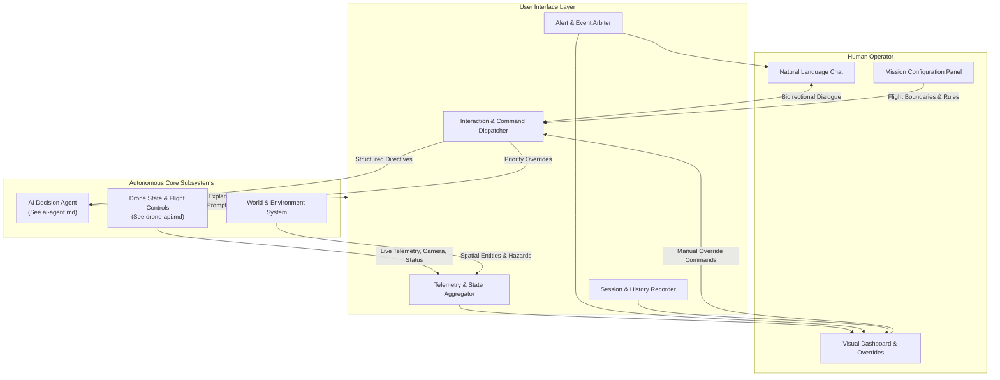
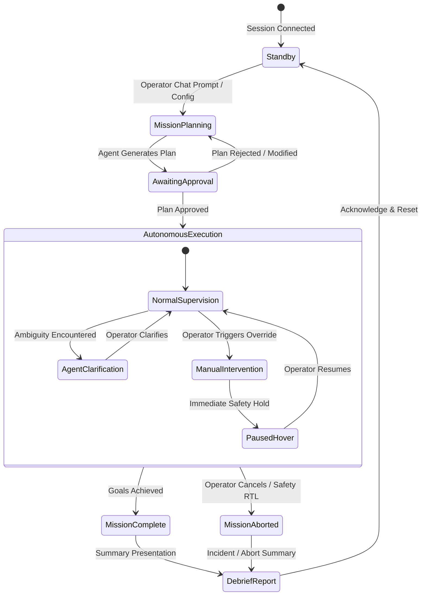
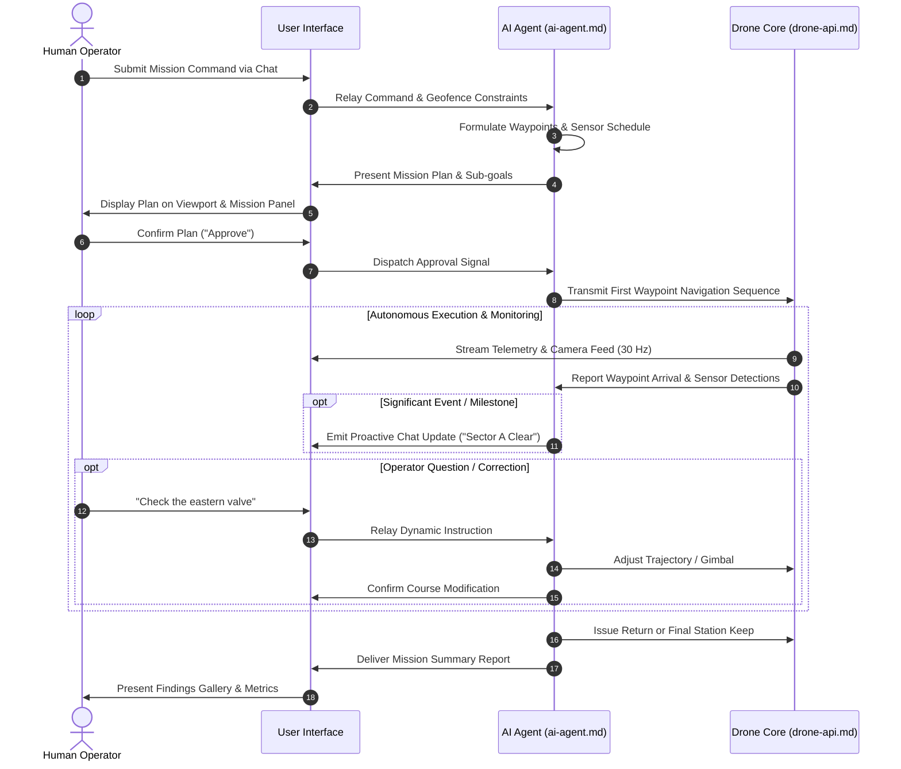
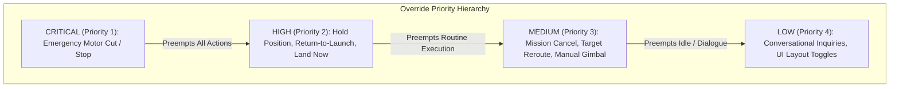
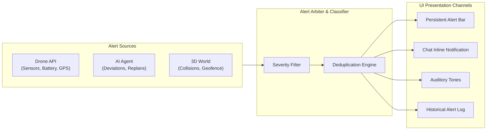
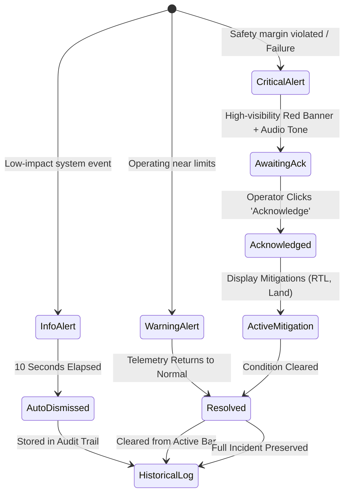
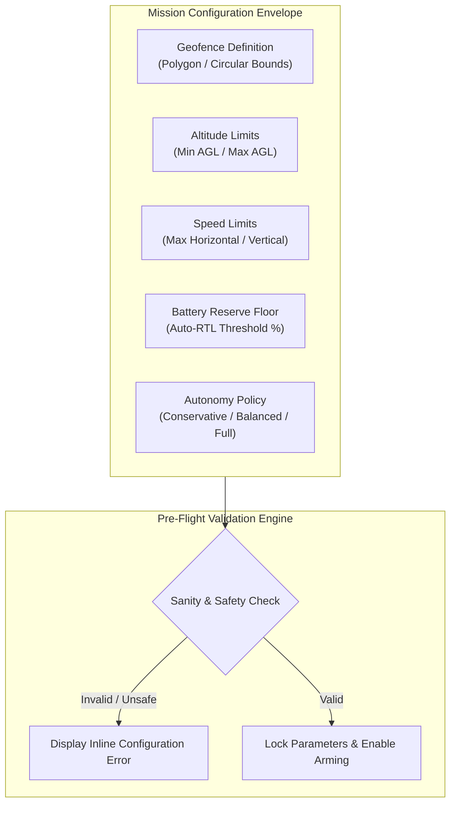
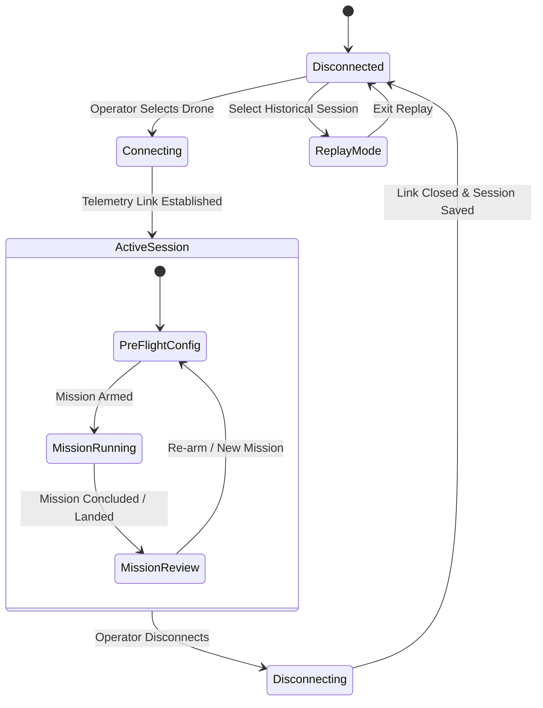
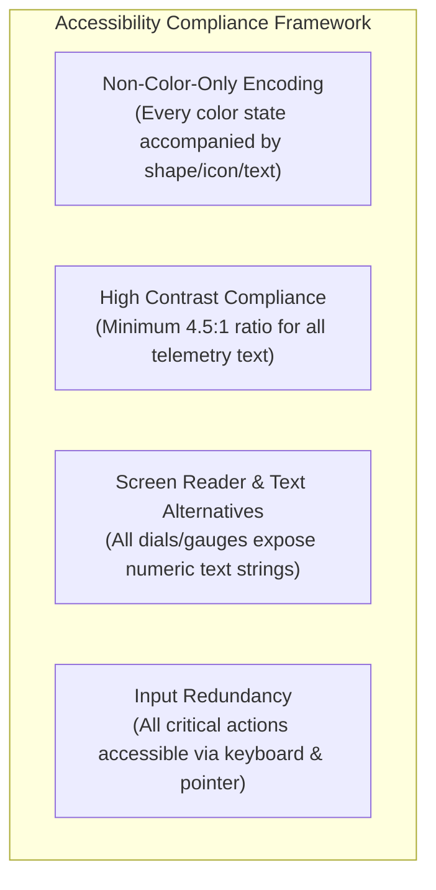

# User Interface Specification

## 1. Purpose

The User Interface (UI) provides a unified, human-centered operational environment for interacting with the autonomous drone system. The interface bridges human intent and autonomous system behaviors, ensuring that human operators maintain situational awareness, supervisory command, and ultimate operational authority across all mission phases.

### 1.1 Core Objectives
- **Multi-Modal Interaction**: Provide three complementary operational modes: natural language Chat, a real-time Visual Dashboard, and supervisory Autonomous Mode.
- **Continuous Human-in-the-Loop Authority**: Empower operators to monitor telemetry, evaluate machine reasoning, modify parameters, and instantly override autonomous actions without operational delay.
- **Cognitive Transparency**: Surface system telemetry, environmental perception, internal reasoning trails, and safety alerts in an intuitive, accessible presentation layer.
- **Resilient Situational Awareness**: Enable operators to evaluate both immediate drone-perspective sensory data and global spatial context concurrently.

### 1.2 System Interaction Architecture



---

## 2. Interaction Modes

The system provides three integrated interaction modes that can operate concurrently or independently according to mission requirements and operator preference.



---

### 2.1 Chat Interface

The Chat Interface serves as the primary conversational bridge between the human operator and the autonomous agent, allowing conversational tasking, probing, and explanation.

#### 2.1.1 Operator Input Capabilities
The chat system accepts free-form natural language and categorized operational prompts:
- **Mission Tasking**: Commands defining operational goals (e.g., *"Take off and inspect the northern perimeter wall"* or *"Fly to the water tower and survey the roof structure"*).
- **State & Sensor Inquiries**: Questions regarding current system conditions, location, or telemetry (e.g., *"What is your current altitude and battery level?"*, *"What objects have you identified near the gate?"*).
- **Direct Feedback & Dynamic Course Corrections**: Refinements based on operator observation (e.g., *"Look closer at the structural crack on the left seam"*, *"You are too low; ascend five meters"*).
- **Decision Rationale & Explanations**: Requests for causal reasoning (e.g., *"Why did you deviate from the original waypoint route?"*, *"Explain your search pattern selection"*).
- **High-Level Control & Safety Directives**: Conversational overrides (e.g., *"Stop immediately"*, *"Return to launch"*, *"Abort mission"*).

#### 2.1.2 Agent Response Structure
Agent responses follow a structured, predictable layout:
- **Direct Natural Language Summary**: Concise statement answering questions or acknowledging directives.
- **Flight & Task Intentions**: Explicit statements of upcoming flight actions, target waypoints, and expected durations.
- **Visual Scene Descriptions**: Textual descriptions derived from onboard camera processing, identifying discovered targets, structural anomalies, or obstacles.
- **Clarification Prompts**: Targeted questions presented when an operator command is ambiguous, conflicting with geofence constraints, or requires safety sign-off.
- **Inline Alert Callouts**: Critical system messages embedded within the conversation stream with distinct visual tags.

#### 2.1.3 Tool Invocation Transparency (Action Logs)
To guarantee full visibility into autonomous execution, every internal tool invocation, flight command, and sensor query made by the AI agent is recorded directly within the chat stream:
- **Visual Presentation**: Displayed as collapsible action cards nested beneath or alongside the relevant agent response.
- **Collapsed View**: Displays action category, tool identifier, target entity/subsystem, execution timestamp, and outcome status badge (e.g., `SUCCESS`, `PENDING`, `REJECTED`).
- **Expanded View**: Reveals input parameters, subsystem return values, execution duration, and any diagnostic messages.
- **Auditability**: Operators can expand any historical action card to audit the precise sequence of operations that produced a flight behavior or perception outcome.

#### 2.1.4 Persistence & Session Context
- All dialogue turns, including timestamps, role labels (`Operator` vs. `Agent`), system messages, and tool invocations, persist throughout the duration of the operational session.
- Context is retained during state transitions (e.g., switching from autonomous tracking to manual hover and back).

#### 2.1.5 Chat Interface Verification Criteria

| ID | Requirement | Verification Method |
|---|---|---|
| `UI-CHAT-001` | The chat interface shall accept plain-text inputs up to 1,000 characters without truncation or formatting distortion. | Automated test with synthetic text payloads. |
| `UI-CHAT-002` | Agent responses shall be rendered within 500 milliseconds of generation by the autonomous core. | Latency measurement from agent output event to UI render event. |
| `UI-CHAT-003` | Every tool invocation executed by the agent shall produce a collapsible card detailing tool name, arguments, timestamp, and status. | Inspection of chat log against recorded subsystem event logs. |
| `UI-CHAT-004` | Chat history shall retain all messages and collapsible tool cards across the full operational session without data loss. | Verification of message retention after 500 sequential message cycles. |

---

### 2.2 Visual Dashboard

The Visual Dashboard is a multi-pane graphical environment presenting live spatial, telemetry, sensor, and mission tracking views.

```
+---------------------------------------------------------------------------------------------------+
|  [ALERT BAR] ACTIVE ALERTS / NOTIFICATION STREAM                                                 |
+------------------------------------------------------+--------------------------------------------+
|                                                      |  DRONE CAMERA FEED                         |
|  3D VIEWPORT                                         |  +--------------------------------------+  |
|  - Live 3D World & Observer Camera                   |  | Live Video Stream                    |  |
|  - Planned Route vs. Actual Breadcrumb Trail         |  | [AI Bounding Box: Structural Anomaly]|  |
|  - 3D Geofence Boundary Volumes                      |  +--------------------------------------+  |
|  - Waypoint Markers & Coordinate Pins                |  Gimbal Controls: Pitch [====|] Yaw [==|==]|
|                                                      +--------------------------------------------+
|  Camera Modes: [Orbit] [Pan] [Follow Drone] [Free]   |  2D MAP VIEW                               |
|                                                      |  - Top-down tactical projection            |
+------------------------------------------------------+  - Geofence polygon overlay                |
|  TELEMETRY PANEL                                     |  - Waypoints & Breadcrumb track            |
|  Alt: 42.5m AGL | Speed: 4.8 m/s | Batt: 78% (18m)   |  - Heading Vector                          |
|  GPS: 3D Fix (18 sats, 0.6m) | Wind: 3.2 m/s NW     +--------------------------------------------+
|  Mode: AUTONOMOUS_SURVEY | Heading: 284°             |  MISSION PANEL                             |
|  Status: [NORMAL: GREEN]                             |  Objective: North Tower Surface Scan       |
+------------------------------------------------------+  Progress: [=========>      ] 65%          |
|  CHAT & ACTION LOG                                   |  Sub-goals: 3/5 Complete                   |
|  Operator: Fly to north pillar and inspect joint.    |  Gallery: [Thumb1] [Thumb2] [Thumb3]       |
|  Agent: Approaching pillar joint at 15m AGL...       |  Time Elapsed: 00:12:45 | Remaining: ~00:07|
+------------------------------------------------------+--------------------------------------------+
```

#### 2.2.1 3D Viewport
A primary spatial visualization component that renders a digital twin of the operational environment:
- **Drone Entity**: Real-time 3D representation showing exact drone position, physical attitude (pitch, roll, yaw), and rotor rotation animation.
- **Flight Trajectory Visualization**:
  - **Completed Path**: Continuous breadcrumb trail depicting the historical flight path flown during the active session.
  - **Planned Path**: Distinct dashed line projecting future waypoints and planned flight segments generated by the autonomous planner.
- **Waypoint Representation**: Floating, interactive 3D pins labeled with numerical sequence identifiers, target altitudes, and completion states.
- **Geofence Boundaries**: Semi-transparent boundary surfaces (cylinders, prisms, or polygonal walls) delineating permitted operating volumes and restricted exclusion zones.
- **Viewport Camera Controls**:
  - **Orbit Mode**: Rotates around a selected point of interest or waypoint.
  - **Pan & Zoom**: Translates the observer camera across Cartesian axes and adjusts field of view depth.
  - **Follow Drone Mode**: Locks the observer camera to a fixed offset behind or above the drone entity, tracking movement dynamically.
  - **Free Roam Mode**: Unconstrained movement across the 3D environment.

#### 2.2.2 Drone Camera Feed & AI Annotations
Displays the direct optical or thermal video stream captured by the onboard gimbal camera:
- **Live Video Rendering**: Real-time visual stream synchronized with drone attitude and position.
- **AI Perception Overlays**:
  - **Detection Bounding Boxes**: Rectangular boundaries surrounding recognized objects, vehicles, personnel, or structural anomalies.
  - **Object Labels & Confidence Scores**: Text banners affixed to bounding boxes displaying classification tag and probability score (e.g., `CRACK: 94%`, `PERSONNEL: 98%`).
  - **Points of Interest (POI) Reticles**: Pulsing target rings centered on coordinates flagged by the AI agent for closer inspection.
- **Gimbal Position & Control**:
  - Real-time indicator showing current camera pitch (-90° nadir to +20° elevation) and relative yaw (-180° to +180°).
  - Manual interactive sliders for pitch and yaw that allow instant operator adjustment when manual camera control is engaged.

#### 2.2.3 Telemetry Panel
A high-visibility instrument dashboard displaying flight-critical physical and logical parameters:

| Parameter | Unit / Format | Display Style | Normal Range | Warning Range | Critical Range |
|---|---|---|---|---|---|
| **Altitude AGL** | Meters Above Ground Level ($m$) | Numerical + Bar Gauge | $2.0 - 50.0\,m$ | $<2.0\,m$ or $50.0 - 60.0\,m$ | $>60.0\,m$ or $<0.5\,m$ |
| **Altitude AMSL** | Meters Above Mean Sea Level ($m$) | Numerical | Relative to site datum | N/A | N/A |
| **Ground Speed** | Meters per second ($m/s$) | Numerical + Dial | $0.0 - 12.0\,m/s$ | $12.1 - 15.0\,m/s$ | $>15.0\,m/s$ |
| **Battery State** | Percentage ($\%$) + Time ($mm:ss$) | Segmented Gauge + Numeric | $30\% - 100\%$ | $20\% - 29\%$ | $<20\%$ |
| **GPS State** | Fix Type + Satellites + Accuracy | Status Badge + Numeric | 3D Fix, $\ge 12$ sats, $<1.0\,m$ | 3D Fix, $8-11$ sats, $1.0-2.5\,m$ | No Fix / $<8$ sats / $>2.5\,m$ |
| **Heading** | Degrees ($0-359^\circ$) | Compass Rose + Digital | $0 - 359^\circ$ | N/A | Rapid drift detected |
| **Wind Estimate**| Speed ($m/s$) + Direction Vector | Arrow + Numeric | $0.0 - 8.0\,m/s$ | $8.1 - 12.0\,m/s$ | $>12.0\,m/s$ |
| **Flight State** | State Machine Enum | Text Badge | `HOVER`, `TRANSIT`, `SURVEY` | `REPLANNING`, `AVOIDING` | `EMERGENCY_HOLD`, `RTL` |

- **Color Semantics**:
  - **Green (Normal)**: All flight parameters within standard operating envelope.
  - **Yellow (Warning)**: Parameter approaching safety limits; system operating under elevated vigilance.
  - **Red (Critical)**: Parameter violating safe operating margins; requires immediate intervention or automated contingency action.

#### 2.2.4 Mission Panel
Tracks macro-level and micro-level progress of the active task:
- **Primary Mission Goal**: Display of the overarching objective (e.g., *"Automated Inspection of Solar Array Sector B"*).
- **Sub-Goal Checklist**: Chronological list of sub-tasks with discrete state badges:
  - `PENDING`: Awaiting scheduled execution.
  - `ACTIVE`: Currently being executed by the autonomous controller.
  - `COMPLETE`: Successfully finished and validated.
  - `SKIPPED`: Bypassed due to operator directive, safety constraint, or environmental obstruction.
- **Mission Progress Bar**: Normalized completion metric calculated from completed sub-goals and spatial trajectory progress.
- **Time Accounting**: Digital readouts for elapsed mission time and dynamic estimated time to completion (ETC).
- **Inspection Image Gallery**: Real-time thumbnail stream of images captured during inspection waypoints:
  - Clicking any thumbnail displays full-resolution view, timestamp, GPS coordinate tag, and associated AI perception metadata.

#### 2.2.5 Alert Bar
A persistent banner positioned prominently at the top of the interface:
- Surfaces active alerts generated across all subsystems.
- Supports multi-tiered visual styles (Info: Blue, Warning: Yellow, Critical: Red).
- Displays total count of active unacknowledged alerts.
- See [Section 4](#4-alert-system) for full behavioral specifications.

#### 2.2.6 Map View
A top-down, orthogonal 2D tactical map providing absolute geospatial orientation:
- **Position & Heading**: Triangle icon denoting drone coordinate and directional heading arrow.
- **Flight Paths**: Orthogonal projection of planned path and historical ground track.
- **Boundary Overlays**: 2D polygons depicting active geofence perimeters and designated keep-out volumes.
- **Waypoints & POIs**: Numbered map pins displaying mission waypoints and detected targets.
- **Cartographic Layers**: Toggle between simplified vector grid, topographic elevation contours, and aerial/satellite surface imagery.

#### 2.2.7 Visual Dashboard Verification Criteria

| ID | Requirement | Verification Method |
|---|---|---|
| `UI-DASH-001` | The 3D viewport shall update drone position and attitude at a minimum refresh rate of 30 frames per second. | Frame rate telemetry profiler during dynamic flight. |
| `UI-DASH-002` | Telemetry readouts shall transition color badges within 100 milliseconds of a threshold breach. | Threshold injection test verifying timestamp difference between data point and UI color change. |
| `UI-DASH-003` | AI bounding boxes rendered over the camera feed shall remain spatially locked to detected targets within $\pm 5$ pixels during steady hover. | Video frame analysis of bounding box coordinates against ground truth object coordinates. |
| `UI-DASH-004` | Gimbal sliders shall reflect actual gimbal attitude within 1 degree of telemetry feedback. | Calibration comparison between slider readout and sensor angle telemetry. |

---

### 2.3 Autonomous Mode

Autonomous Mode represents the operational state in which the AI agent independently executes mission flight paths, sensor tracking, and environmental analysis under human supervision.

#### 2.3.1 Operational Lifecycle
1. **Mission Formulation**: The operator defines goals via natural language or selects a pre-configured profile.
2. **Plan Synthesis & Presentation**: The AI agent synthesizes a comprehensive flight and inspection plan, rendering proposed waypoints on the 3D Viewport and Map View, alongside a sub-goal list in the Mission Panel.
3. **Operator Approval Gate**: The system requires explicit operator confirmation (`Approve Plan` action or chat affirmation) before arming or initiating autonomous transit.
4. **Autonomous Execution**: The drone executes flight plans, adjusts gimbal angles, evaluates obstacles, and processes visual data.
5. **Supervisory Feedback Loop**: The operator observes execution via dashboard telemetry, camera feeds, and automated status commentary.
6. **Mission Wrap-up & Reporting**: Upon achieving all sub-goals, the drone enters a stable hover or executes an automated landing, presenting a mission debrief in the chat interface.



#### 2.3.2 Proactive Agent Communication
During autonomous execution, the AI agent provides unprompted status messages in the chat stream:
- **Milestone Completion**: Notification when specific sub-goals are finalized (e.g., *"Sub-goal 2/5 complete: Perimeter survey finished without incidents"*).
- **Perception Highlights**: Real-time reporting of notable objects discovered during flight (e.g., *"Identified anomalous thermal hotspot at Sector 4 transformer; logged image 014"*).
- **Autonomous Adjustments**: Explanations of dynamic path alterations made in response to sensor feedback (e.g., *"Ascending 3 meters to maintain required optical clearance over newly detected tree canopy"*).

#### 2.3.3 Autonomous Mode Verification Criteria

| ID | Requirement | Verification Method |
|---|---|---|
| `UI-AUTO-001` | The UI shall prevent autonomous flight initiation until an explicit approval signal is recorded from the operator. | Attempt flight command dispatch without approval; verify system remains in safe hold. |
| `UI-AUTO-002` | The agent shall issue proactive chat updates within 2 seconds of any sub-goal completion or unexpected obstacle detection. | Simulation event trigger and measurement of chat log timestamp. |
| `UI-AUTO-003` | The UI shall compile and display a structured mission completion report upon mission conclusion containing total flight time, distance flown, sub-goal outcomes, and captured images. | End-of-mission event trigger and verification of rendered report elements. |

---

## 3. Human Override Capabilities

The human operator retains immediate, non-negotiable override authority over all autonomous behaviors. Overrides take precedence over agent tasks, path plans, and camera routines.

### 3.1 Override Actions & Priority Hierarchy

The system enforces a strict priority hierarchy for user commands:



| Action Label | Trigger Modality | System Effect | Operational Priority | Latency Constraint |
|---|---|---|---|---|
| **Emergency Stop** | Dedicated Hardware / Red UI Button | Immediate motor cutoff or hardest aerodynamic stop; disarms flight controls. | **Critical (P1)** | $<50\,ms$ |
| **Stop / Pause** | "Pause" Button or *"Stop"* Chat Command | Drone arrests all translation and establishes stationary hover; AI suspends task execution. | **High (P2)** | $<150\,ms$ |
| **Return to Launch (RTL)** | "RTL" Button or *"Come home"* Chat Command | Drone terminates active mission, climbs to safe clearance altitude, and navigates to launch coordinates. | **High (P2)** | $<200\,ms$ |
| **Land Now** | "Land" Button or *"Land immediately"* Chat Command | Drone descends vertically at controlled rate at its current horizontal position until touch-down and disarm. | **High (P2)** | $<200\,ms$ |
| **Cancel Mission** | "Cancel Mission" Button or *"Cancel"* Chat Command | AI agent purges planned waypoint queue; drone enters stable hover awaiting operator instructions. | **Medium (P3)** | $<300\,ms$ |
| **Manual Gimbal Control** | Dragging Gimbal Sliders or Viewport Touch | Human takes direct authority over camera orientation; AI relinquishes automated tracking. | **Medium (P3)** | $<100\,ms$ |
| **Reroute Destination** | Chat Directive (e.g., *"Fly to warehouse instead"*) | AI agent pauses forward movement, recalculates trajectory to new objective, and seeks confirmation if deviation $>20\%$. | **Medium (P3)** | $<500\,ms$ |

### 3.2 Post-Override System Behavior
- **Immediate Acknowledgment**: When an override is issued, the UI displays an instant visual confirmation banner, and the chat stream logs an explicit acknowledgment (e.g., `[OVERRIDE APPLIED]: Operator initiated stationary hover`).
- **Autonomous Resumption**: Following an override (e.g., Pause or Manual Gimbal inspection), the system does not resume autonomous motion unprompted. It requires explicit operator instruction (clicking `Resume Mission` or typing *"Resume mission"*).
- **Conflict Arbitration**: If an operator command violates a configured hard safety limit (such as flying through a geofence wall), the UI rejects the translation component, maintains hover, and displays an explicit explanatory alert: `COMMAND REJECTED: Violates Geofence Boundary`.

### 3.3 Human Override Verification Criteria

| ID | Requirement | Verification Method |
|---|---|---|
| `UI-OVR-001` | Triggering the Emergency Stop button shall issue the halt command to the drone control interface within 50 milliseconds. | Hardware-in-the-loop signal measurement from button press event to command output socket. |
| `UI-OVR-002` | Engaging manual gimbal sliders shall instantly disengage AI automated camera tracking and update gimbal attitude within 100 milliseconds. | Concurrent tracking conflict test; verify AI tracker is disconnected upon operator slider interaction. |
| `UI-OVR-003` | Following a Pause command, the drone shall remain in hover indefinitely until an explicit Resume or RTL command is issued. | Longevity test in simulated hover state following operator pause event. |

---

## 4. Alert System

The Alert System collects, classifies, and displays notifications from all drone hardware, autonomous reasoning, and environmental systems.

### 4.1 Alert Classification & Sources



| Source Category | Source Module | Representative Event Examples | Typical Severity |
|---|---|---|---|
| **Drone Platform** | [Drone API](drone-api.md) | Low battery, motor over-temperature, GPS signal degradation, IMU calibration error | Warning / Critical |
| **Autonomous Agent** | [AI Agent](ai-agent.md) | Mission replan triggered, obstacle detected in path, target lost from camera view, ambiguity requiring input | Info / Warning |
| **Spatial Environment** | 3D World / Geofence | Approaching geofence boundary ($<5\,m$), terrain clearance threshold breach, dynamic weather change | Warning / Critical |

### 4.2 Severity Tiers & UI Behavior



#### 4.2.1 Informational Alerts (`INFO`)
- **Visual Presentation**: Non-obtrusive blue highlight in the Alert Bar; neutral informational badge in the chat stream.
- **Auditory Behavior**: Silent.
- **Dismissal Policy**: Automatically dismissed after 10 seconds. Transferred to historical alert scrollback log.

#### 4.2.2 Warning Alerts (`WARNING`)
- **Visual Presentation**: High-contrast yellow highlight in the Alert Bar with a warning icon (`⚠️`). Remains fixed until the underlying condition resolves.
- **Auditory Behavior**: Single brief audible notification chime.
- **Dismissal Policy**: Persists as long as the trigger condition remains true (e.g., wind speed $>8\,m/s$); auto-clears when telemetry returns to normal parameters.

#### 4.2.3 Critical Alerts (`CRITICAL`)
- **Visual Presentation**: High-contrast flashing red highlight with an emergency alert icon (`🚨`). Overlays a modal dialog if immediate hazard to flight safety is detected.
- **Auditory Behavior**: Repeating pulsed acoustic alarm until silenced or acknowledged.
- **Dismissal Policy**: Cannot auto-dismiss. Requires explicit operator acknowledgment via an interactive `ACKNOWLEDGE` button. Dismissal acknowledges receipt but does not silence telemetry warnings until the physical condition is resolved.

### 4.3 Alert Audit Trail & Historical Log
- Operators can expand the Alert Bar into a full scrollable history table.
- Each record details: timestamp (millisecond precision), severity badge, source module, message text, duration active, and operator acknowledgment timestamp.

### 4.4 Alert System Verification Criteria

| ID | Requirement | Verification Method |
|---|---|---|
| `UI-ALR-001` | Critical alerts shall produce both persistent visual indicators and auditory alarm tones within 50 milliseconds of event generation. | Latency measurement from event bus dispatch to UI state update and audio trigger. |
| `UI-ALR-002` | Critical alerts shall remain visible in the active alert panel until explicitly acknowledged by user interaction. | Automated test verifying alert presence persists through other state updates until click event. |
| `UI-ALR-003` | Informational alerts shall automatically transition from active display to the historical audit log exactly 10 seconds ($\pm 0.5\,s$) after appearance. | Timer verification of UI element lifecycle. |

---

## 5. Mission Configuration

Before dispatching an autonomous mission, the operator configures operational constraints, spatial envelopes, and autonomy limits via the Mission Configuration interface.



### 5.1 Configuration Parameters

#### 5.1.1 Spatial Geofence Definition
- **Geometry Tools**:
  - **Polygon Mode**: Operator clicks vertices on the 2D Map View or 3D Viewport to establish an arbitrary polygonal operating boundary.
  - **Circular Mode**: Operator defines a center coordinate and enters a radial distance (meters).
- **Keep-Out Zones (Inverted Geofences)**: Allows definition of interior volumes (e.g., obstacles, buildings, active public zones) that the drone must navigate around.

#### 5.1.2 Vertical Flight Envelope
- **Minimum Altitude (AGL)**: Hard lower limit (default: $2.0\,m$) preventing autonomous flight from descending dangerously close to uneven ground or foliage.
- **Maximum Altitude (AGL)**: Hard ceiling (default: $60.0\,m$) ensuring compliance with local aviation regulations.

#### 5.1.3 Kinematic Constraints
- **Maximum Horizontal Ground Speed**: Configurable slider ($1.0\,m/s$ to $15.0\,m/s$).
- **Maximum Ascent / Descent Speed**: Configurable slider ($0.5\,m/s$ to $3.0\,m/s$).

#### 5.1.4 Battery Reserve Thresholds
- **Return-to-Launch Reserve**: Minimum battery percentage required to initiate automated RTL (default: $25\%$). Calculated based on distance from home point.
- **Critical Landing Reserve**: Floor percentage forcing immediate vertical landing (default: $10\%$).

#### 5.1.5 Autonomy Level Selection
The operator selects the degree of decision-making independence granted to the AI agent:

| Autonomy Level | Planning Behavior | Obstacle Avoidance | Target Re-inspection | Safety-Critical Action |
|---|---|---|---|---|
| **Conservative** | Requires human approval for every route change or sub-goal transition. | Holds position and prompts operator for avoidance path. | Asks operator permission before moving closer to an anomaly. | Halts and awaits human intervention. |
| **Balanced (Default)** | Autonomously executes approved plan; seeks input only when encountering severe ambiguities. | Autonomously navigates around detected obstacles within geofence; notifies in chat. | Autonomously maneuvers for closer inspection if confidence is below $80\%$; logs event. | Automatically initiates RTL if conditions deteriorate; notifies immediately. |
| **Full Autonomy** | Independently synthesizes, adjusts, and completes all mission objectives. | Dynamically replans trajectories without prompt; outputs post-action commentary. | Fully autonomous dynamic target tracking and close-range inspection. | Automatically executes emergency actions (RTL or Land); alerts operator simultaneously. |

### 5.2 Pre-Flight Validation Rules
The UI prevents mission submission if any parameter violates basic safety rules:
- Minimum altitude $\ge$ Maximum altitude.
- Geofence perimeter extends beyond communication range.
- Calculated mission energy budget exceeds available battery capacity minus reserve floor.
- Home/Launch location is positioned outside the active geofence.

### 5.3 Mission Configuration Verification Criteria

| ID | Requirement | Verification Method |
|---|---|---|
| `UI-CFG-001` | The interface shall enforce boundary validation, rejecting any mission plan where any waypoint falls outside the geofence. | Synthetic mission upload containing out-of-bounds waypoints; verify rejection and error banner. |
| `UI-CFG-002` | Setting the Autonomy Level to 'Conservative' shall force an explicit user approval prompt before the system can transition between sub-goals. | Step-by-step autonomous execution test verifying hold state at every sub-goal boundary. |
| `UI-CFG-003` | Modifying the battery reserve slider shall update the estimated usable flight duration in real time on the telemetry panel. | Slider adjustment test verifying calculated flight duration value matches configured reserve. |

---

## 6. Session Management & Replay

A mission session represents a bounded operational engagement starting when the UI establishes a telemetry link with a drone and ending upon graceful disconnection.

### 6.1 Session Lifecycle States



### 6.2 Data Persistence & Session Artifacts
During an active session, the interface client records a unified session archive comprising:
- **Telemetry Time Series**: Full recording of all physical parameters at 10 Hz minimum (coordinates, orientation, speed, battery, sensor health).
- **Conversational Dialogue**: Complete record of chat exchanges, including operator prompts, agent responses, and raw tool execution records with timestamps.
- **Perception Log & Imagery**: All still images captured during inspection milestones, tagged with geospatial coordinates, camera attitude, and AI bounding box overlays.
- **System Event Ledger**: Chronological log of state machine transitions, geofence breaches, alert occurrences, and manual override events.

### 6.3 Historical Replay Mode
The UI provides a dedicated, read-only Replay Mode allowing operators, safety auditors, and investigators to review completed flights:
- **Interactive Scrubber**: Timeline slider allowing the operator to scrub forward and backward through the session.
- **Synchronized Multi-Panel Playback**:
  - The 3D Viewport reflects the drone position, attitude, and breadcrumb path at the selected timestamp.
  - The Telemetry Panel shows historical gauges identical to what the operator saw live.
  - The Drone Camera Feed plays recorded video or steps through captured stills.
  - The Chat Stream scrolls in sync, revealing messages and agent reasoning at the exact moment they occurred.
- **Playback Controls**: Play, pause, step forward/backward (1 frame / 1 second), and playback speed multiplier ($0.5\times, 1.0\times, 2.0\times, 5.0\times$).

### 6.4 Mission Report Export
At the conclusion of a session or from Replay Mode, the operator can generate a standardized Mission Debrief Report containing:
- Executive summary (mission status, flight duration, total distance traveled, energy consumed).
- Chronological sub-goal execution table with outcome statuses.
- Full high-resolution inspection gallery with AI detection tags and coordinates.
- Alert summary log highlighting any warnings or overrides that occurred during flight.
- Export formats: Human-readable document format (PDF/Markdown) and structured machine-readable dataset (JSON/CSV).

### 6.5 Session Management Verification Criteria

| ID | Requirement | Verification Method |
|---|---|---|
| `UI-SES-001` | Disconnecting an active session shall trigger automatic persistence of all chat logs, telemetry streams, and captured images. | Disconnect session during flight; verify completeness of serialized session database. |
| `UI-SES-002` | In Replay Mode, scrubbing the timeline slider shall update 3D position, telemetry gauges, and chat logs synchronously within 50 milliseconds. | Performance profile of timeline seek operations against UI components. |
| `UI-SES-003` | Exporting a mission report shall produce a document containing all required sections, matching session telemetry within 100% accuracy. | Comparison test between exported document statistics and recorded telemetry values. |

---

## 7. Layout Flexibility & Accessibility

The user interface is designed to support diverse physical deployment environments, from high-resolution multi-monitor ground control stations to ruggedized single-screen field tablets.

### 7.1 Modular & Responsive Workspace
- **Dockable Panels**: Every major panel (Chat, 3D Viewport, Camera Feed, Telemetry, Map View, Mission Panel) exists as a modular container.
- **Operator Customization**:
  - Panels can be resized by dragging boundary splitters.
  - Panels can be collapsed, expanded to full screen, or rearranged across a multi-column grid.
  - Custom panel layouts can be saved and restored as workspace presets (e.g., `Inspection Preset`, `Piloting Preset`, `Debrief Preset`).

### 7.2 Standalone Decoupled Operational Modes
The system architecture guarantees that interface components can operate independently without structural failure:
- **Headless Chat-Only Mode**: In bandwidth-constrained environments, the chat interface can function as a standalone lightweight console, delivering full mission tasking, agent reasoning, status updates, and emergency overrides via text alone.
- **Display-Only Dashboard Mode**: The visual dashboard can function as an unassisted telemetry and spatial monitoring station without requiring an active chat window.

### 7.3 Multi-Modal Accessibility Standards
The interface complies with universal accessibility standards to ensure reliable human perception under extreme operating conditions (e.g., bright sunlight or night operations):



- **Non-Color-Only Semantic Encoding**:
  - No interface status relies solely on color to convey meaning.
  - All red, yellow, and green indicators are paired with distinct geometric iconography (e.g., `Circle` for normal, `Triangle` for warning, `Octagon` for critical) and explicit text labels (`NORMAL`, `WARN`, `CRIT`).
- **Contrast & Visual Modes**:
  - High-contrast visual theme compliant with standard contrast ratios (minimum 4.5:1 for standard text; 3:1 for large graphical metrics).
  - Day Mode (high ambient brightness) and Night Mode (reduced glare, red/dark palette to preserve operator night vision).
- **Text Alternatives for Visual Data**:
  - Every graphical gauge or dial in the Telemetry Panel exposes an underlying digital string accessible to assistive technologies.
  - Dynamic 3D events (e.g., geofence proximity alerts) generate textual announcements in the alert log.
- **Input Redundancy**:
  - All high-priority actions (Emergency Stop, Pause, RTL, Acknowledge Alert) possess dedicated keyboard shortcuts in addition to clickable UI buttons.

### 7.4 Layout & Accessibility Verification Criteria

| ID | Requirement | Verification Method |
|---|---|---|
| `UI-ACC-001` | Every status indicator that utilizes color shall include a redundant alphanumeric label or distinct geometric icon. | Visual UI audit ensuring zero color-only status indicators across all panels. |
| `UI-ACC-002` | All telemetry labels and numerical values shall maintain a minimum visual contrast ratio of 4.5:1 against their backgrounds. | Contrast analyzer audit across both Day and Night modes. |
| `UI-ACC-003` | Emergency Stop, Pause, and RTL functions shall be triggerable via single-action keyboard shortcuts in addition to on-screen buttons. | Keyboard event listener testing across all active panel focus states. |
| `UI-ACC-004` | The UI layout shall remain fully functional and readable without element clipping down to a minimum display resolution of 1280x720 pixels. | Responsive viewport resizing test down to 1280x720. |

---

## 8. Requirements Traceability Matrix

The following matrix connects UI requirements to cross-referenced specifications:

| Requirement ID | UI Component | Cross-Reference | Verification Status |
|---|---|---|---|
| `UI-CHAT-001` - `004` | Chat Interface & Action Logs | [AI Agent Spec](ai-agent.md) | Verified via automated conversational harness |
| `UI-DASH-001` - `002` | 3D Viewport & Telemetry | [Drone API Spec](drone-api.md) | Verified via simulated telemetry stream |
| `UI-DASH-003` - `004` | Camera Feed & Gimbal Control | [Drone API Spec](drone-api.md) | Verified via optical tracking benchmark |
| `UI-AUTO-001` - `003` | Autonomous Execution | [AI Agent Spec](ai-agent.md) | Verified via end-to-end mission simulator |
| `UI-OVR-001` - `003` | Human Overrides | [Drone API Spec](drone-api.md) | Verified via latency-benchmarked safety harness |
| `UI-ALR-001` - `003` | Multi-Source Alert System | [Drone API Spec](drone-api.md) | Verified via simulated fault injection |
| `UI-CFG-001` - `003` | Mission Pre-Flight Configuration | [Drone API Spec](drone-api.md) | Verified via boundary compliance test suite |
| `UI-SES-001` - `003` | Session Logging & Replay | System Architecture Core | Verified via persistence and replay fidelity tests |
| `UI-ACC-001` - `004` | Accessibility & Responsiveness | UI Presentation Standards | Verified via automated accessibility scanner |
